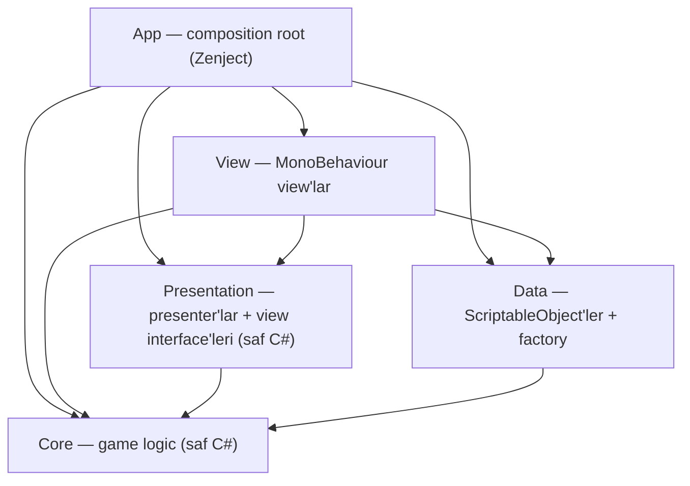

# Merge Game — Unity Developer Case Study

Vuvy "Unity Developer Case Study — Merge game mechanics" için hazırlanmış, portrait ekranlı bir mobil merge oyunu. Game logic ve presentation logic saf C# ile yazıldı (`UnityEngine` referansı yok) ve Unity scene'i olmadan unit test'lerle doğrulanıyor.

| | |
|---|---|
| Unity | 6000.6.6f1, URP 2D, uGUI + TextMesh Pro, yeni Input System |
| DI | Extenject (Zenject) 9.2.0 (OpenUPM) |
| Animasyon | Spine 3.8 (müşteri karakterleri), projeye ait küçük bir tween helper'ı |
| Test | Unity Test Framework: 450'den fazla EditMode, 40'tan fazla PlayMode testi |

## Çalıştırma

1. Projeyi Unity Hub'dan **6000.6.6f1** ile açın; package'lar ilk açılışta kendiliğinden resolve edilir.
2. [Assets/MergeGame/Scenes/MainMenu.unity](Assets/MergeGame/Scenes/MainMenu.unity) scene'ini açın.
3. Game view'ı portrait bir aspect ratio'ya alıp Play'e basın.

Testler: **Window → General → Test Runner** → EditMode / PlayMode → Run All.

## Mimari

**Tercih: layered architecture + MVP (Passive View).** Kod, dependency'lerin tek yöne aktığı assembly'lere bölündü. Yön `asmdef` referanslarıyla compile-time'da zorlanır; Core ve Presentation `noEngineReferences: true` olduğu için Unity'yi göremez.

| Layer | Sorumluluğu |
|---|---|
| [Core](Assets/MergeGame/Core) | Grid, merge rule'ları, spawn, score, order'lar. Yalnızca .NET bilir. |
| [Presentation](Assets/MergeGame/Presentation) | Presenter'lar: ne zaman highlight edilir, hangi notice çıkar, button aktif mi. Yalnızca Core'u bilir. |
| [Data](Assets/MergeGame/Data) | ScriptableObject tanımları ve bunları Core tiplerine çeviren factory. |
| [View](Assets/MergeGame/View) | Passive view'lar: input event'i yayar, kendisine verilen komutu canlandırır. Core'dan yalnızca value type'ları (`ItemId`, `GridPosition`) kullanır; session'a erişmez, rule bilmez. |
| [App](Assets/MergeGame/App) | Zenject installer'ları, scene geçişi, save. Game logic içermez. |

**Bir oyuncu eyleminin akışı (drag & drop ile merge):**

1. `BoardView` pointer hareketini cell event'ine çevirir (`DragStarted`, `DragMoved`, `DragReleased`).
2. `BoardPresenter` drag boyunca `session.PreviewDrop` ile sonucu sorar ve hedef cell'i highlight eder; bırakınca `session.Drop` çağırır.
3. [MergeGameSession](Assets/MergeGame/Core/Session/MergeGameSession.cs) drop'u rule pipeline'ından geçirir, board'u günceller ve sıralı event'ler yayar (`ItemsMerged`, `ScoreChanged`, ...).
4. Presenter'lar bu event'leri view çağrılarına çevirir (`MergeItems`, `ChangeScore`, ...); view yalnızca animasyonu oynatır.

Grid state'inin tek sahibi `MergeGameSession`'dır: `Board` class'ı `internal`, diğer her yer onu `IReadOnlyBoard` olarak görür.

**Neden bu yaklaşım:**

- **Testability.** Rule'lar ve presentation kararları Unity açılmadan, milisaniyeler içinde test edilir.
- **Değiştirilebilir view layer'ı.** uGUI yerine başka bir UI yazmak, presenter ve rule'lara dokunmadan yeni bir View layer'ı demektir.
- **Deterministic rule'lar.** Randomness `IRandom` ile dışarıdan inject edilir; aynı seed aynı oyunu üretir.

**Değerlendirilen alternatifler:**

| Alternatif | Neden seçilmedi |
|---|---|
| Logic'in MonoBehaviour'larda olması | Rule'lar scene olmadan test edilemez; rule ile animasyon birbirine karışır. |
| MVVM + data binding | uGUI'de binding altyapısı yok; animasyonlu geçişler state değil event gerektiriyor. |
| ECS | 25 cell'lik event-driven bir oyunda kazancı yok, okuma maliyeti yüksek. |
| Singleton / service locator | Dependency'leri gizler, testte değiştirmeyi zorlaştırır. |

## Item tanım yapısı

Item'lar data-driven tanımlıdır: kodda değil asset'lerde durur. Kodda hiçbir chain adı geçmez.

**Authoring (ScriptableObject)** — Inspector'da **Create → Merge Game → …** menüsünden oluşturulur:

| Asset | İçeriği |
|---|---|
| [GameConfigAsset](Assets/MergeGame/Data/Authoring/GameConfigAsset.cs) | Grid boyutu (`boardWidth`, `boardHeight`), chain listesi, score table, order ayarları, initial layout |
| [ItemChainAsset](Assets/MergeGame/Data/Authoring/ItemChainAsset.cs) | Bir chain: `id`, `displayName`, `spawnWeight`, `scoreMultiplier`, `levels` |
| [ItemLevelEntry](Assets/MergeGame/Data/Authoring/ItemLevelEntry.cs) | Bir level: `displayName` ve `icon`. Level numarası listedeki index'tir; boşluk ya da tekrar oluşamaz. |
| [ScoreTableAsset](Assets/MergeGame/Data/Authoring/ScoreTableAsset.cs) | `pointsByLevel`: oluşan level'a göre merge puanı |

**Runtime** — [GameDefinitionFactory](Assets/MergeGame/Data/Definitions/GameDefinitionFactory.cs) bu asset'leri Core'un immutable tiplerine (`ItemCatalog`, `ItemId`, `BoardSize`, `ScoreTable`) çevirir ve içeriği bir kez, bu sınırda validate eder. İki ayrı temsil olmasının nedeni: Core Unity'yi göremediği için `ScriptableObject` veya `Sprite` tutamaz; ayrıca oyun ortasında değişen bir asset session'ı bozamaz. Sprite'lar Core'a girmez; View onları `ItemId` üzerinden `IItemVisuals`'tan alır.

Hatalı içerik (eksik sprite, tekrar eden id, score table'dan uzun chain) [GameConfigValidator](Assets/MergeGame/Data/Validation/GameConfigValidator.cs) ile edit-time'da Console'a warning olarak düşer.

**Neden ScriptableObject:** Inspector'da düzenlenir, sprite'lara doğrudan referans verir, parsing kodu gerektirmez. Alternatifler: runtime'da JSON (sprite'lar kırılgan string path'lerle bağlanır), enum + `switch` (her chain kod değişikliği demek), item başına prefab (data'yı görsele bağlar).

**Yeni chain eklemek (kod değişikliği yok):**

1. **Create → Merge Game → Item Chain** ile yeni bir asset oluşturun.
2. `id`, `displayName`, `spawnWeight`, `scoreMultiplier` girin; `levels` listesine level'ları ad ve icon ile ekleyin.
3. Chain'i [GameConfig.asset](Assets/MergeGame/Content/Config/GameConfig.asset) içindeki `chains` listesine ekleyin.

Yeni chain spawn edilir, merge olur, puan verir ve order'larda istenir. Bu akış `ShippedContentTests.NewChainAddedAsDataOnly_SpawnsMergesAndHasVisuals` testiyle doğrulanır. Grid boyutu da aynı şekilde yalnızca `GameConfig` üzerinden değişir.

## Tasarım kalıpları (design patterns)

| Pattern | Nerede | Neden | Seçilmeyen alternatif |
|---|---|---|---|
| **MVP / Passive View** | [Presentation](Assets/MergeGame/Presentation): `I*View` + `*Presenter` | View karar vermez; tüm presentation logic'i fake view'larla Unity'siz test edilir. | MVVM; her şeyi bilen tek bir `GameController` |
| **Facade** | [MergeGameSession](Assets/MergeGame/Core/Session/MergeGameSession.cs) | Presentation tek entry point görür (`Drop`, `Spawn`, `DeliverOrder`). Board'u değiştirip event'i unutmak mümkün olmaz. | Board, score ve order'ları ayrı ayrı expose etmek |
| **Chain of Responsibility** | [IDropRule](Assets/MergeGame/Core/Rules/IDropRule.cs), [DropResolver](Assets/MergeGame/Core/Rules/DropResolver.cs) | Her drop sıralı rule'lardan geçer, ilk karar veren kazanır. Kilitli item ve kumla kaplı cell mekanikleri birer rule eklenerek geldi; `MergeRule` değişmedi. Preview ve gerçek drop aynı path'i kullanır. | `Drop` içinde büyüyen `if/else` |
| **Strategy** | [ISpawnPolicy](Assets/MergeGame/Core/Spawning/ISpawnPolicy.cs), [IScoreCalculator](Assets/MergeGame/Core/Scoring/IScoreCalculator.cs), [IOrderGenerator](Assets/MergeGame/Core/Orders/IOrderGenerator.cs), [IRandom](Assets/MergeGame/Core/Spawning/IRandom.cs) | Değişmesi muhtemel policy'ler session'a dışarıdan verilir; testlerde randomness sabitlenir. | Inheritance; doğrudan `UnityEngine.Random` |
| **Observer** | `MergeGameSession.EventRaised`, [SessionEventStream](Assets/MergeGame/Presentation/Events/SessionEventStream.cs) | Core tek, sıralı bir event stream yayar; presenter'lar typed subscribe olur. Event sırası garantilidir ve test edilir. | Event başına ayrı C# event'i (sıra garantisi yok); ScriptableObject event channel'ları (Core'u Unity'ye bağlar) |
| **Factory** | [GameDefinitionFactory](Assets/MergeGame/Data/Definitions/GameDefinitionFactory.cs) | Unity asset'lerini Core tiplerine tek bir sınırda çevirir ve validate eder. | Core'un ScriptableObject'leri doğrudan okuması |
| **Dependency Injection** | [App/Installers](Assets/MergeGame/App/Installers) | Object graph tek yerde kurulur; her class'ın neye ihtiyacı constructor'ında görünür. Core, Presentation ve Data Zenject'i bilmez. | Singleton; elle `new` yapan bir bootstrap |
| **Object Pool** | `ItemView.Pool`, `PointsPopup.Pool` | Her spawn ve merge'de `Instantiate`/`Destroy` yapılmaz; mobilde GC spike'larını önler. | Her seferinde yeni GameObject |

## Case gereksinimleri

| Gereksinim | Nerede |
|---|---|
| Ana menü, Oyna, Çıkış, menüye dönüş | [MainMenuPresenter](Assets/MergeGame/Presentation/MainMenu/MainMenuPresenter.cs), [GameNavigationPresenter](Assets/MergeGame/Presentation/Navigation/GameNavigationPresenter.cs), [SceneNavigator](Assets/MergeGame/App/Navigation/SceneNavigator.cs) |
| 5×5 grid, boyut hard-coded değil | `GameConfig.boardWidth/Height` → [BoardSize](Assets/MergeGame/Core/Grid/BoardSize.cs) |
| Grid state'i tek merkezi yapıda | [Board](Assets/MergeGame/Core/Grid/Board.cs) (`internal`), yalnızca `MergeGameSession` değiştirir |
| ≥3 chain, her biri ≥5 level | 4 chain × 7 level: [Content/Config/Chains](Assets/MergeGame/Content/Config/Chains) |
| Drag & drop ile merge | [MergeRule](Assets/MergeGame/Core/Rules/MergeRule.cs) |
| Max level merge olmaz, oyuncuya söylenir | `DropRejectReason.MaxLevel` → notice; drag sırasında ayrı renkte highlight |
| Başarısız merge item'ı yerine döndürür | `DropRejected` event'i → `IBoardView.ReturnItem` |
| Drag sırasında hedef gösterilir | `PreviewDrop` → [DropHighlightView](Assets/MergeGame/View/Board/DropHighlightView.cs) |
| "Üret": random chain'in level 1 item'ı, boş cell'e | [WeightedRandomSpawnPolicy](Assets/MergeGame/Core/Spawning/WeightedRandomSpawnPolicy.cs) |
| Grid doluyken button disabled | `BoardFullChanged` → [SpawnPresenter](Assets/MergeGame/Presentation/Spawning/SpawnPresenter.cs) |
| Level'a göre artan, data-driven puan | [ScoreTableCalculator](Assets/MergeGame/Core/Scoring/ScoreTableCalculator.cs), [ScoreTable.asset](Assets/MergeGame/Content/Config/ScoreTable.asset) |
| Güncel score hep görünür | [ScorePresenter](Assets/MergeGame/Presentation/Score/ScorePresenter.cs) |

Brief'in ötesinde eklenenler: kilitli (baloncuklu) item'lar, kumla kaplı cell'ler, müşteri order'ları, idle hint, item discard, info bar, chain kataloğu popup'ı, JSON save, ses ve haptic ayarları.

## Testler

| Assembly | Kapsam |
|---|---|
| [Core.Tests](Assets/MergeGame/Core.Tests) | Grid, drop rule'ları, spawn, score, order'lar, event sırası |
| [Presentation.Tests](Assets/MergeGame/Presentation.Tests) | Her presenter, fake view'lar ve gerçek session ile |
| [Data.Tests](Assets/MergeGame/Data.Tests) | Factory, validator, shipped content (5×5, ≥3 chain ≥5 level) |
| [View.Tests](Assets/MergeGame/View.Tests) | Kum dökülmesi modeli, müşteri animasyon akışı |
| [PlayTests](Assets/MergeGame/PlayTests) | Gerçek scene'lerde end-to-end: menü, spawn, drag & drop ile merge, save |

Animasyon timing'leri, renkler ve layout bilinçli olarak test edilmedi; bunlar gözle kontrol edilir.

## Bilinen kısıtlar

- **Fiziksel cihazda çalıştırılmadı.** Touch input, safe area ve `Application.Quit` yalnızca Editor'de doğrulandı.
- **Grid yalnızca dikdörtgen.** Delikli ya da şekilli board desteklenmiyor.
- **Save tek slot'lu.** İçerik save ile uyuşmayacak biçimde değişirse migration yapılmaz, yeni oyun başlar.
- **Strategy'ler Inspector'dan seçilemiyor.** Farklı bir spawn ya da score policy'si kod gerektirir; factory her zaman default'ları kullanır.
- **Order teslimi otomatik match eder.** Oyuncu aynı item'ın hangi kopyasının gideceğini seçemez; order'ların süresi yok.
- **Scene'ler bir Editor tool'u ile generate ediliyor** (**Merge Game → Build Scenes**). Tool'u yeniden çalıştırmak scene'lerde ve prefab'larda elle yapılan değişiklikleri siler.
- **Spine 3.8 runtime'ı Unity 6 için patch'lendi** ([UNITY6_PATCHES.md](Packages/com.esotericsoftware.spine.spine-unity/UNITY6_PATCHES.md)); resmi olarak desteklenmiyor.
- **Localization ve volume ayarı yok.** Metinler Türkçe; ses yalnızca açılıp kapatılır.
- **Balance örnek amaçlı.** Puanlar ve spawn weight'leri gameplay verisiyle ayarlanmadı.

## Third-party asset'ler

Extenject (MIT), Spine Runtimes (Spine Runtimes License), Baloo 2 font'u (OFL 1.1), Microsoft Fluent Emoji (MIT) ve proje sahibinin lisansladığı asset pack ile müşteri karakterleri. Ayrıntılar: [THIRD-PARTY-NOTICES.md](THIRD-PARTY-NOTICES.md).
