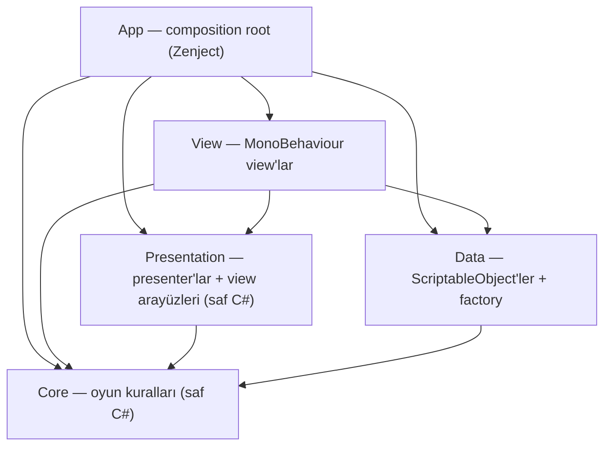

# Merge Game — Unity Developer Case Study

Vuvy "Unity Developer Case Study — Merge game mechanics" için hazırlanmış, dikey ekranlı bir mobil merge oyunu. Oyun kuralları ve sunum mantığı saf C# ile yazıldı (`UnityEngine` referansı yok) ve Unity sahnesi olmadan birim testleriyle doğrulanıyor.

| | |
|---|---|
| Unity | 6000.6.6f1, URP 2D, uGUI + TextMesh Pro, yeni Input System |
| DI | Extenject (Zenject) 9.2.0 (OpenUPM) |
| Animasyon | Spine 3.8 (müşteri karakterleri), projeye ait küçük bir tween yardımcısı |
| Test | Unity Test Framework: 450'den fazla EditMode, 40'tan fazla PlayMode testi |

## Çalıştırma

1. Projeyi Unity Hub'dan **6000.6.6f1** ile açın; paketler ilk açılışta kendiliğinden çözülür.
2. [Assets/MergeGame/Scenes/MainMenu.unity](Assets/MergeGame/Scenes/MainMenu.unity) sahnesini açın.
3. Game görünümünü dikey bir orana alıp Play'e basın.

Testler: **Window → General → Test Runner** → EditMode / PlayMode → Run All.

## Mimari

**Tercih: katmanlı mimari + MVP (Passive View).** Kod, bağımlılığın tek yöne aktığı assembly'lere bölündü. Yön `asmdef` referanslarıyla derleme seviyesinde zorlanır; Core ve Presentation `noEngineReferences: true` olduğu için Unity'yi göremez.

| Katman | Sorumluluğu |
|---|---|
| [Core](Assets/MergeGame/Core) | Grid, merge kuralları, spawn, skor, siparişler. Yalnızca .NET bilir. |
| [Presentation](Assets/MergeGame/Presentation) | Presenter'lar: ne zaman vurgulanır, hangi bildirim çıkar, buton aktif mi. Yalnızca Core'u bilir. |
| [Data](Assets/MergeGame/Data) | ScriptableObject tanımları ve bunları Core tiplerine çeviren factory. |
| [View](Assets/MergeGame/View) | Pasif view'lar: girdi olayı yayar, kendisine verilen komutu canlandırır. Core'dan yalnızca değer tiplerini (`ItemId`, `GridPosition`) kullanır; oturuma erişmez, kural bilmez. |
| [App](Assets/MergeGame/App) | Zenject installer'ları, sahne geçişi, kayıt. Oyun mantığı içermez. |

**Bir oyuncu eyleminin akışı (sürükle-birleştir):**

1. `BoardView` parmak hareketini hücre olayına çevirir (`DragStarted`, `DragMoved`, `DragReleased`).
2. `BoardPresenter` sürükleme boyunca `session.PreviewDrop` ile sonucu sorar ve hedef hücreyi vurgular; bırakınca `session.Drop` çağırır.
3. [MergeGameSession](Assets/MergeGame/Core/Session/MergeGameSession.cs) bırakmayı kural hattından geçirir, tahtayı günceller ve sıralı olaylar yayar (`ItemsMerged`, `ScoreChanged`, ...).
4. Presenter'lar bu olayları view komutlarına çevirir (`MergeItems`, `ChangeScore`, ...); view yalnızca animasyonu oynatır.

Grid durumunun tek sahibi `MergeGameSession`'dır: `Board` sınıfı `internal`, diğer her yer onu `IReadOnlyBoard` olarak görür.

**Neden bu yaklaşım:**

- **Test edilebilirlik.** Kurallar ve sunum kararları Unity açılmadan, milisaniyeler içinde test edilir.
- **Değiştirilebilir görsel katman.** uGUI yerine başka bir arayüz yazmak, presenter ve kurallara dokunmadan yeni bir View katmanı demektir.
- **Deterministik kurallar.** Rastgelelik `IRandom` ile dışarıdan verilir; aynı tohum aynı oyunu üretir.

**Değerlendirilen alternatifler:**

| Alternatif | Neden seçilmedi |
|---|---|
| Mantığın MonoBehaviour'larda olması | Kurallar sahne olmadan test edilemez; kural ile animasyon birbirine karışır. |
| MVVM + data binding | uGUI'de binding altyapısı yok; animasyonlu geçişler durum değil olay gerektiriyor. |
| ECS | 25 hücrelik olay güdümlü bir oyunda kazancı yok, okuma maliyeti yüksek. |
| Singleton / service locator | Bağımlılıkları gizler, testte değiştirmeyi zorlaştırır. |

## Item tanım yapısı

Item'lar kodda değil veride tanımlıdır. Kodda hiçbir zincir adı geçmez.

**Authoring (ScriptableObject)** — Inspector'da **Create → Merge Game → …** menüsünden oluşturulur:

| Asset | İçeriği |
|---|---|
| [GameConfigAsset](Assets/MergeGame/Data/Authoring/GameConfigAsset.cs) | Grid boyutu (`boardWidth`, `boardHeight`), zincir listesi, skor tablosu, sipariş ayarları, açılış dizilimi |
| [ItemChainAsset](Assets/MergeGame/Data/Authoring/ItemChainAsset.cs) | Bir zincir: `id`, `displayName`, `spawnWeight`, `scoreMultiplier`, `levels` |
| [ItemLevelEntry](Assets/MergeGame/Data/Authoring/ItemLevelEntry.cs) | Bir seviye: `displayName` ve `icon`. Seviye numarası listedeki sıradır; boşluk ya da tekrar oluşamaz. |
| [ScoreTableAsset](Assets/MergeGame/Data/Authoring/ScoreTableAsset.cs) | `pointsByLevel`: oluşan seviyeye göre merge puanı |

**Runtime** — [GameDefinitionFactory](Assets/MergeGame/Data/Definitions/GameDefinitionFactory.cs) bu asset'leri Core'un değiştirilemez tiplerine (`ItemCatalog`, `ItemId`, `BoardSize`, `ScoreTable`) çevirir ve içeriği bir kez, bu sınırda doğrular. İki ayrı temsil olmasının nedeni: Core Unity'yi göremediği için `ScriptableObject` veya `Sprite` tutamaz; ayrıca oyun ortasında değişen bir asset oturumu bozamaz. Sprite'lar Core'a girmez; View onları `ItemId` üzerinden `IItemVisuals`'tan alır.

Hatalı içerik (eksik sprite, tekrar eden id, skor tablosundan uzun zincir) [GameConfigValidator](Assets/MergeGame/Data/Validation/GameConfigValidator.cs) ile düzenleme anında Console'a uyarı olarak düşer.

**Neden ScriptableObject:** Inspector'da düzenlenir, sprite'lara doğrudan referans verir, ayrıştırma kodu gerektirmez. Alternatifler: çalışma zamanında JSON (sprite'lar kırılgan string yollarla bağlanır), enum + `switch` (her zincir kod değişikliği demek), item başına prefab (veriyi görsele bağlar).

**Yeni zincir eklemek (kod değişikliği yok):**

1. **Create → Merge Game → Item Chain** ile yeni bir asset oluşturun.
2. `id`, `displayName`, `spawnWeight`, `scoreMultiplier` girin; `levels` listesine seviyeleri ad ve ikonla ekleyin.
3. Zinciri [GameConfig.asset](Assets/MergeGame/Content/Config/GameConfig.asset) içindeki `chains` listesine ekleyin.

Yeni zincir üretilir, birleşir, puan verir ve siparişlerde istenir. Bu akış `ShippedContentTests.NewChainAddedAsDataOnly_SpawnsMergesAndHasVisuals` testiyle doğrulanır. Grid boyutu da aynı şekilde yalnızca `GameConfig` üzerinden değişir.

## Tasarım kalıpları

| Kalıp | Nerede | Neden | Seçilmeyen alternatif |
|---|---|---|---|
| **MVP / Passive View** | [Presentation](Assets/MergeGame/Presentation): `I*View` + `*Presenter` | View karar vermez; tüm sunum mantığı sahte view'larla Unity'siz test edilir. | MVVM; her şeyi bilen tek bir `GameController` |
| **Facade** | [MergeGameSession](Assets/MergeGame/Core/Session/MergeGameSession.cs) | Presentation tek giriş noktası görür (`Drop`, `Spawn`, `DeliverOrder`). Tahtayı değiştirip olayı unutmak mümkün olmaz. | Board, skor ve siparişleri ayrı ayrı açmak |
| **Chain of Responsibility** | [IDropRule](Assets/MergeGame/Core/Rules/IDropRule.cs), [DropResolver](Assets/MergeGame/Core/Rules/DropResolver.cs) | Her bırakma sıralı kurallardan geçer, ilk karar veren kazanır. Kilitli item ve kumla kaplı hücre mekanikleri birer kural eklenerek geldi; `MergeRule` değişmedi. Önizleme ve gerçek bırakma aynı yolu kullanır. | `Drop` içinde büyüyen `if/else` |
| **Strategy** | [ISpawnPolicy](Assets/MergeGame/Core/Spawning/ISpawnPolicy.cs), [IScoreCalculator](Assets/MergeGame/Core/Scoring/IScoreCalculator.cs), [IOrderGenerator](Assets/MergeGame/Core/Orders/IOrderGenerator.cs), [IRandom](Assets/MergeGame/Core/Spawning/IRandom.cs) | Değişmesi muhtemel politikalar oturuma dışarıdan verilir; testlerde rastgelelik sabitlenir. | Kalıtım; doğrudan `UnityEngine.Random` |
| **Observer** | `MergeGameSession.EventRaised`, [SessionEventStream](Assets/MergeGame/Presentation/Events/SessionEventStream.cs) | Core tek, sıralı bir olay akışı yayar; presenter'lar tipli abone olur. Olay sırası garantilidir ve test edilir. | Olay başına ayrı C# event'i (sıra garantisi yok); ScriptableObject event channel'ları (Core'u Unity'ye bağlar) |
| **Factory** | [GameDefinitionFactory](Assets/MergeGame/Data/Definitions/GameDefinitionFactory.cs) | Unity asset'lerini Core tiplerine tek bir sınırda çevirir ve doğrular. | Core'un ScriptableObject'leri doğrudan okuması |
| **Dependency Injection** | [App/Installers](Assets/MergeGame/App/Installers) | Nesne grafiği tek yerde kurulur; her sınıfın neye ihtiyacı constructor'ında görünür. Core, Presentation ve Data Zenject'i bilmez. | Singleton; elle `new` yapan bir bootstrap |
| **Object Pool** | `ItemView.Pool`, `PointsPopup.Pool` | Her spawn ve merge'de `Instantiate`/`Destroy` yapılmaz; mobilde GC takılmalarını önler. | Her seferinde yeni GameObject |

## Case gereksinimleri

| Gereksinim | Nerede |
|---|---|
| Ana menü, Oyna, Çıkış, menüye dönüş | [MainMenuPresenter](Assets/MergeGame/Presentation/MainMenu/MainMenuPresenter.cs), [GameNavigationPresenter](Assets/MergeGame/Presentation/Navigation/GameNavigationPresenter.cs), [SceneNavigator](Assets/MergeGame/App/Navigation/SceneNavigator.cs) |
| 5×5 grid, boyut hard-coded değil | `GameConfig.boardWidth/Height` → [BoardSize](Assets/MergeGame/Core/Grid/BoardSize.cs) |
| Grid durumu tek merkezi yapıda | [Board](Assets/MergeGame/Core/Grid/Board.cs) (`internal`), yalnızca `MergeGameSession` değiştirir |
| ≥3 zincir, her biri ≥5 seviye | 4 zincir × 7 seviye: [Content/Config/Chains](Assets/MergeGame/Content/Config/Chains) |
| Sürükle-bırak merge | [MergeRule](Assets/MergeGame/Core/Rules/MergeRule.cs) |
| Maksimum seviye birleşmez, oyuncuya söylenir | `DropRejectReason.MaxLevel` → bildirim; sürüklerken ayrı renkte vurgu |
| Başarısız merge item'ı yerine döndürür | `DropRejected` olayı → `IBoardView.ReturnItem` |
| Sürüklerken hedef gösterilir | `PreviewDrop` → [DropHighlightView](Assets/MergeGame/View/Board/DropHighlightView.cs) |
| "Üret": rastgele zincirin 1. seviyesi, boş hücreye | [WeightedRandomSpawnPolicy](Assets/MergeGame/Core/Spawning/WeightedRandomSpawnPolicy.cs) |
| Grid doluyken buton pasif | `BoardFullChanged` → [SpawnPresenter](Assets/MergeGame/Presentation/Spawning/SpawnPresenter.cs) |
| Seviyeyle artan, veri odaklı puan | [ScoreTableCalculator](Assets/MergeGame/Core/Scoring/ScoreTableCalculator.cs), [ScoreTable.asset](Assets/MergeGame/Content/Config/ScoreTable.asset) |
| Güncel skor hep görünür | [ScorePresenter](Assets/MergeGame/Presentation/Score/ScorePresenter.cs) |

Brief'in ötesinde eklenenler: kilitli (baloncuklu) item'lar, kumla kaplı hücreler, müşteri siparişleri, boşta kalma ipucu, item atma, bilgi çubuğu, zincir kataloğu penceresi, JSON kayıt, ses ve titreşim ayarları.

## Testler

| Assembly | Kapsam |
|---|---|
| [Core.Tests](Assets/MergeGame/Core.Tests) | Grid, bırakma kuralları, spawn, skor, siparişler, olay sırası |
| [Presentation.Tests](Assets/MergeGame/Presentation.Tests) | Her presenter, sahte view'lar ve gerçek oturumla |
| [Data.Tests](Assets/MergeGame/Data.Tests) | Factory, validator, sevk edilen içerik (5×5, ≥3 zincir ≥5 seviye) |
| [View.Tests](Assets/MergeGame/View.Tests) | Kum dökülmesi modeli, müşteri animasyon akışı |
| [PlayTests](Assets/MergeGame/PlayTests) | Gerçek sahnelerde uçtan uca: menü, üretme, sürükle-birleştir, kayıt |

Animasyon zamanlamaları, renkler ve yerleşim bilinçli olarak test edilmedi; bunlar gözle kontrol edilir.

## Bilinen kısıtlar

- **Fiziksel cihazda çalıştırılmadı.** Dokunma, safe area ve `Application.Quit` yalnızca editörde doğrulandı.
- **Grid yalnızca dikdörtgen.** Delikli ya da şekilli tahta desteklenmiyor.
- **Kayıt tek yuvalı.** İçerik kayıtla uyuşmayacak biçimde değişirse kayıt göç ettirilmez, yeni oyun başlar.
- **Stratejiler Inspector'dan seçilemiyor.** Farklı bir spawn ya da skor politikası kod gerektirir; factory her zaman varsayılanları kullanır.
- **Sipariş teslimi otomatik eşleşir.** Oyuncu aynı item'ın hangi kopyasının gideceğini seçemez; siparişlerin süresi yok.
- **Sahneler bir editör aracıyla üretiliyor** (**Merge Game → Build Scenes**). Aracı yeniden çalıştırmak sahnelerde ve prefab'larda elle yapılan değişiklikleri siler.
- **Spine 3.8 runtime'ı Unity 6 için yamalandı** ([UNITY6_PATCHES.md](Packages/com.esotericsoftware.spine.spine-unity/UNITY6_PATCHES.md)); resmi olarak desteklenmiyor.
- **Yerelleştirme ve ses düzeyi ayarı yok.** Metinler Türkçe; ses yalnızca açılıp kapatılır.
- **Denge örnek amaçlı.** Puanlar ve spawn ağırlıkları oynanış verisiyle ayarlanmadı.

## Üçüncü taraf varlıklar

Extenject (MIT), Spine Runtimes (Spine Runtimes License), Baloo 2 yazı tipi (OFL 1.1), Microsoft Fluent Emoji (MIT) ve proje sahibinin lisansladığı asset paketi ile müşteri karakterleri. Ayrıntılar: [THIRD-PARTY-NOTICES.md](THIRD-PARTY-NOTICES.md).
