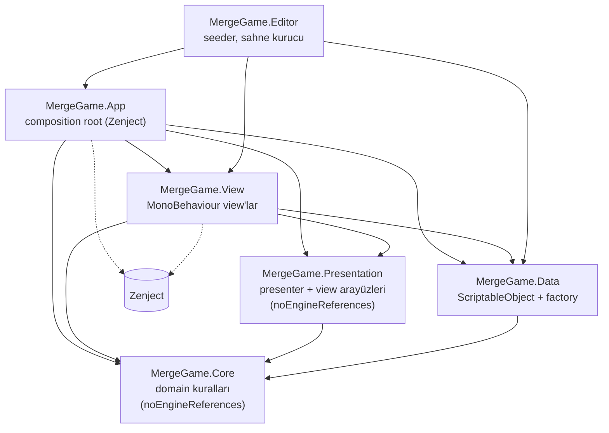

# Merge Game — Unity Developer Case Study

Vuvy "Unity Developer Case Study — Merge game mechanics" için hazırlanmış, portre (dikey) mobil arayüzlü bir merge oyunu. Oyunun çekirdeği ve sunum mantığı saf C# ile yazıldı (`UnityEngine` referansı yok) ve görsel katman olmadan birim testleriyle doğrulanıyor. Görseller ile mekanikler ayrı assembly'lerde duruyor, bağımlılıklar Zenject ile tek bir composition root'ta bağlanıyor.

| | |
|---|---|
| Unity | **6000.6.6f1** ([ProjectVersion.txt](ProjectSettings/ProjectVersion.txt)) |
| Render / UI | URP 2D, uGUI + TextMesh Pro, yeni Input System |
| DI | Extenject (Zenject) 9.2.0, OpenUPM üzerinden ([manifest.json](Packages/manifest.json)) |
| Animasyon | Spine 3.8 (spine-unity runtime, Unity 6 için yamalı, [Packages/com.esotericsoftware.spine.spine-unity](Packages/com.esotericsoftware.spine.spine-unity) altında gömülü paket) |
| Test | Unity Test Framework (NUnit), EditMode + PlayMode |

## İçindekiler

1. [Hızlı başlangıç](#hızlı-başlangıç)
2. [Case gereksinimleri kontrol listesi](#case-gereksinimleri-kontrol-listesi)
3. [Mimari](#mimari)
4. [Item tanım yapısı](#item-tanım-yapısı)
5. [Tasarım desenleri](#tasarım-desenleri)
6. [Testler](#testler)
7. [Proje yapısı](#proje-yapısı)
8. [Brief'in ötesindeki özellikler](#briefin-ötesindeki-özellikler)
9. [Bilinen kısıtlar ve sonraki adımlar](#bilinen-kısıtlar-ve-sonraki-adımlar)
10. [Araçlar ve üçüncü taraf varlıklar](#araçlar-ve-üçüncü-taraf-varlıklar)

## Hızlı başlangıç

1. Projeyi Unity Hub'dan **6000.6.6f1** ile açın. Paketler (Extenject dahil, OpenUPM scoped registry ile) ilk açılışta otomatik çözülür.
2. [Assets/MergeGame/Scenes/MainMenu.unity](Assets/MergeGame/Scenes/MainMenu.unity) sahnesini açın.
3. Game görünümünü dikey bir en-boy oranına ayarlayıp Play'e basın.

Sahneler, prefab'lar ve Zenject `ProjectContext`'i repoda hazır gelir; yeniden üretmek gerekmez (bkz. [Araçlar](#araçlar-ve-üçüncü-taraf-varlıklar)).

**Oyunda neler yapılabilir:** Ana menüde "Oyna" oyun sahnesini açar, "Çıkış" uygulamayı kapatır. 5×5 tahta, bir kısmı kilitli (örümcek ağlı) item'lar ve içi görünmeyen kumla kaplı (kapalı) hücrelerle dolu bir açılış dizilimiyle başlar. "Üret" butonu rastgele bir zincirin 1. seviye item'ını boş bir hücreye koyar; yeni item yaklaşık bir saniye parlar. Aynı zincirden ve aynı seviyedeki iki item'ı sürükleyip üst üste bırakınca bir üst seviye oluşur ve seviyeye göre artan puan kazanılır; sürükleme sırasında hedef hücre, bırakmanın sonucuna göre (taşıma, birleşme, geçersiz, maksimum seviye) vurgulanır ve birleşme mümkünse hedef item'ın kendisi parlar. Uyuşmayan bir bırakma item'ı geldiği hücreye geri gönderir ve oyuncuya nedenini söyleyen kısa bir bildirim gösterir. Kilitli bir item'ın üzerine eşini birleştirmek onu serbest bırakır; serbest kalan hücrenin dört komşusundaki kumla kaplı hücrelerin kumu hücrenin içinde aşağı dökülerek boşalır ve alttaki item ağlı olarak ortaya çıkar. Oyuncu bir süre hiçbir şey yapmazsa, birleştirilebilecek iki item bir kez birbirine doğru atılıp dinlenmeye döner; oyuncu hareketsiz kaldıkça ipucu aralıklarla yinelenir. Üst şeritteki müşteri sipariş kartları, istenen item'lar tahtadayken teslim butonuyla tamamlanır; tahtada bir siparişin alacağı item'lar yeşil bir onay rozeti ve hafif yeşil bir hale ile işaretlidir; item'lar müşteriye uçar ve ek puan kazanılır. Tahtanın altındaki bilgi çubuğu, dokunulan item'ın adını, seviyesini ve bir sonraki seviyesini gösterir; buradan item atılabilir, böylece dolu bir tahta asla çıkmaza girmez. Oyun ekranındaki ev butonu ana menüye döner. Üretme, kaldırma, bırakma, seviyeye göre yükselen birleşme sesleri, ağın çözülmesi, kumun dökülmesi, sipariş teslimi ve bildirimler ses efektiyle duyulur; arka plan müziği menüden oyuna kesilmeden sürer.

## Case gereksinimleri kontrol listesi

| Gereksinim | Nasıl karşılanıyor | Kodda nerede |
|---|---|---|
| Ana menü: "Oyna" oyun sahnesini açar | `MainMenuView` → `IMainMenuView.PlayRequested` → `MainMenuPresenter` → `IAppNavigator.OpenGame()`; `SceneNavigator` `SceneManager.LoadScene` ile Game sahnesini yükler | [MainMenuView.cs](Assets/MergeGame/View/MainMenu/MainMenuView.cs), [MainMenuPresenter.cs](Assets/MergeGame/Presentation/MainMenu/MainMenuPresenter.cs), [SceneNavigator.cs](Assets/MergeGame/App/Navigation/SceneNavigator.cs) |
| Çıkış / menüye dönüş butonu | Ana menüde "Çıkış" → `Quit()` (`Application.Quit`, editörde Play Mode'u durdurur); oyunda ev butonu (`GameMenuView`) → `BackToMenuRequested` → `OpenMainMenu()` | [GameNavigationPresenter.cs](Assets/MergeGame/Presentation/Navigation/GameNavigationPresenter.cs), [GameMenuView.cs](Assets/MergeGame/View/Navigation/GameMenuView.cs), [NavigationTests.cs](Assets/MergeGame/Presentation.Tests/NavigationTests.cs) |
| 5×5 grid | `GameConfig.asset` içinde `boardWidth: 5`, `boardHeight: 5`; bir test sevk edilen içeriğin 5×5 olduğunu doğruluyor | [GameConfig.asset](Assets/MergeGame/Content/Config/GameConfig.asset), [ShippedContentTests.cs](Assets/MergeGame/Data.Tests/ShippedContentTests.cs) |
| Boyut kolay değişir, hard-coded değil | Boyut veriden `BoardSize` değer nesnesine akar; kodda 5 sabiti yok. `BoardView` hücreleri normalize hücre dikdörtgenlerine (`BoardGeometry`) bağladığı için her boyuta yerleşim kodu olmadan uyar. Presenter testleri kare olmayan tahtada da çalışıyor | [BoardSize.cs](Assets/MergeGame/Core/Grid/BoardSize.cs), [GameConfigAsset.cs](Assets/MergeGame/Data/Authoring/GameConfigAsset.cs), [BoardGeometry.cs](Assets/MergeGame/View/Board/BoardGeometry.cs), [GameScreenTests.cs](Assets/MergeGame/Presentation.Tests/GameScreenTests.cs) |
| Her hücre boş ya da tek item | `Board` hücre dizisi tutar; dolu hücreye `Place` ve dolu hücreye `Move` istisna fırlatır | [Board.cs](Assets/MergeGame/Core/Grid/Board.cs), [BoardTests.cs](Assets/MergeGame/Core.Tests/BoardTests.cs) |
| Grid durumu tek merkezi yapıda | `Board` `internal`; yalnızca `MergeGameSession` değiştirir, diğer her yer `IReadOnlyBoard` görür | [Board.cs](Assets/MergeGame/Core/Grid/Board.cs), [IReadOnlyBoard.cs](Assets/MergeGame/Core/Grid/IReadOnlyBoard.cs) |
| ≥3 zincir, her biri ≥5 seviye | 4 zincir (`garden`, `cafe`, `sea`, `bakery`), her biri 7 seviye; test ile güvence altında | [Content/Config/Chains](Assets/MergeGame/Content/Config/Chains), `ShippedContentTests.HasAtLeastThreeChainsOfAtLeastFiveLevelsWithIcons` |
| Veri odaklı tanımlar | ScriptableObject asset'leri → doğrulanmış, değiştirilemez Core tanımları | [Data/Authoring](Assets/MergeGame/Data/Authoring), [GameDefinitionFactory.cs](Assets/MergeGame/Data/Definitions/GameDefinitionFactory.cs) |
| Yeni zincir = minimum kod değişikliği | Sıfır kod: yeni bir `ItemChainAsset` + `GameConfig.Chains`'e ekleme. İki test bunu kanıtlıyor | `ShippedContentTests.NewChainAddedAsDataOnly_SpawnsMergesAndHasVisuals`, [DataDrivenChainTests.cs](Assets/MergeGame/Core.Tests/DataDrivenChainTests.cs) |
| Sürükle-bırak ile merge (aynı zincir + aynı seviye → sonraki seviye) | `MergeRule` | [MergeRule.cs](Assets/MergeGame/Core/Rules/MergeRule.cs), [DropTests.cs](Assets/MergeGame/Core.Tests/DropTests.cs) |
| Maks. seviye birleşmez, kullanıcıya söylenir | `DropRejectReason.MaxLevel` → `Notice.MaxLevelReached` (toast: "Bu eşya en yüksek seviyede!"); sürüklerken `DropHighlight.MaxLevel` ayrı renkte; bilgi çubuğunda `ItemInfo.IsMaxLevel` etiketi | [BoardPresenter.cs](Assets/MergeGame/Presentation/Board/BoardPresenter.cs), [NoticeView.cs](Assets/MergeGame/View/Notices/NoticeView.cs), [NoticeTexts.asset](Assets/MergeGame/Content/UI/NoticeTexts.asset) |
| Başarısız merge item'ı yerine döndürür | `DropRejected` olayı → `IBoardView.ReturnItem(from)`; tahta ve skor değişmez (testli). Farklı zincir/seviye için de bildirim | [MergeGameSession.cs](Assets/MergeGame/Core/Session/MergeGameSession.cs), [BoardPresenterTests.cs](Assets/MergeGame/Presentation.Tests/BoardPresenterTests.cs), `GameSmokeTests.DragOntoADifferentItem_ReturnsItToItsCell` |
| Sürüklerken potansiyel hedef gösterilir | Her hücre değişiminde `session.PreviewDrop` (yan etkisiz) → `ShowDropHighlight(cell, DropHighlight)`; `DropHighlightView` hücreyi sonucun renginde boyar. `DropHighlight.Merge` gelince `BoardView` hedef item'ın `ItemAccent`'ini oynatır (parlama, nabız, ışıltı); işaretçi hedeften çıkınca söner | [BoardPresenter.cs](Assets/MergeGame/Presentation/Board/BoardPresenter.cs), [DropHighlightView.cs](Assets/MergeGame/View/Board/DropHighlightView.cs), [ItemAccent.cs](Assets/MergeGame/View/Board/ItemAccent.cs), `BoardFeedbackTests.DraggingOverAMergeTarget_MakesItShine_UntilThePointerLeavesIt` |
| "Üret": rastgele zincirin 1. seviyesi, boş hücreye | `WeightedRandomSpawnPolicy`: zinciri `SpawnWeight`'e göre, hücreyi boş hücreler arasından eşit olasılıkla seçer | [WeightedRandomSpawnPolicy.cs](Assets/MergeGame/Core/Spawning/WeightedRandomSpawnPolicy.cs), [SpawnTests.cs](Assets/MergeGame/Core.Tests/SpawnTests.cs) |
| Grid doluyken buton pasif / uyarı | `BoardFullChanged` → `ISpawnView.SetSpawnAvailable(false)` → `SpawnView` butonu `interactable = false` yapar (gri görünür); presenter'a yine de istek gelirse `SpawnResult.Failure(BoardFull)` → `Notice.BoardFull` | [SpawnPresenter.cs](Assets/MergeGame/Presentation/Spawning/SpawnPresenter.cs), [SpawnView.cs](Assets/MergeGame/View/Spawning/SpawnView.cs), [SpawnPresenterTests.cs](Assets/MergeGame/Presentation.Tests/SpawnPresenterTests.cs) |
| Her merge seviyeyle artan puan verir | Oluşan seviyenin tablo puanı × zincir çarpanı; Core tablo puanlarının azalmamasını, sevk edilen içerik testi kesin artmasını zorunlu kılar | [ScoreTableCalculator.cs](Assets/MergeGame/Core/Scoring/ScoreTableCalculator.cs), [ScoreTable.cs](Assets/MergeGame/Core/Scoring/ScoreTable.cs) |
| Puan değerleri veri odaklı | `ScoreTableAsset.pointsByLevel` + `ItemChainAsset.scoreMultiplier` | [ScoreTable.asset](Assets/MergeGame/Content/Config/ScoreTable.asset), [ScoreTableAsset.cs](Assets/MergeGame/Data/Authoring/ScoreTableAsset.cs) |
| Güncel skor hep görünür | `ScorePresenter` açılışta `SetScore`, her `ScoreChanged`'de `ChangeScore` çağırır; `ScoreView` üst çubukta sayarak günceller | [ScorePresenter.cs](Assets/MergeGame/Presentation/Score/ScorePresenter.cs), [ScoreView.cs](Assets/MergeGame/View/Score/ScoreView.cs), `GameSmokeTests.DragOntoAnEqualItem_Merges_AndTheScoreGoesUp` |

**İddiaları hızlıca doğrulamak için:**

- Core ve Presentation'ın motor bağımsızlığı: [MergeGame.Core.asmdef](Assets/MergeGame/Core/MergeGame.Core.asmdef) ve [MergeGame.Presentation.asmdef](Assets/MergeGame/Presentation/MergeGame.Presentation.asmdef) içinde `"noEngineReferences": true`; bu iki klasörde `UnityEngine` veya `Zenject` geçmez.
- Zenject'in nerede olduğu: `Zenject` referansı yalnızca [MergeGame.App.asmdef](Assets/MergeGame/App/MergeGame.App.asmdef), [MergeGame.View.asmdef](Assets/MergeGame/View/MergeGame.View.asmdef) , `MergeGame.Editor` (ProjectContext prefab'ını üretmek için) ve `MergeGame.PlayTests`'te var; Core, Presentation ve [MergeGame.Data.asmdef](Assets/MergeGame/Data/MergeGame.Data.asmdef) yalnızca `MergeGame.Core`'a referans verir.
- Grid'in tek sahibi: [Board.cs](Assets/MergeGame/Core/Grid/Board.cs) `internal sealed`; `Place`/`Remove`/`Replace`/`Move` çağrıları yalnızca [MergeGameSession.cs](Assets/MergeGame/Core/Session/MergeGameSession.cs) içinde.
- Zincir adlarının kodda geçmemesi: `garden`, `cafe`, `sea`, `bakery` üretim kodunda geçmez; yalnızca içerik asset'lerinde, seed JSON'da ve test verisinde ([TestContent.cs](Assets/MergeGame/Core.Tests/Support/TestContent.cs)) bulunur.
- Bırakma kararlarının tek yeri: [Rules](Assets/MergeGame/Core/Rules) klasörü; presenter yalnızca sonucun türünü vurguya ve bildirime çevirir.

> Bilinçli bir ürün kararı: birçok merge oyunu uyuşmayan iki item'ı bırakınca yer değiştirir (swap). Case başarısız bir merge'ün item'ı geri döndürmesini açıkça istediği için kural hattı swap yapmaz, reddeder (`MergeRule` dolu hedefteki her uyuşmazlığı `Reject` ile bitirir).

## Mimari

### Katmanlar

Kod, bağımlılığın tek yöne aktığı altı assembly'ye ayrılmıştır. Yön `asmdef` referanslarıyla zorlanır; Core ve Presentation `noEngineReferences: true` olduğundan `UnityEngine`'i derleme seviyesinde göremez.



(Editor, sahneleri kurmak için App, View, Data, Presentation ve Core'un hepsine referans verir; şemada sadeleştirildi.)

| Katman | Bilebilir | Bilemez |
|---|---|---|
| [Core](Assets/MergeGame/Core) | Yalnızca .NET | Unity, Zenject, ScriptableObject, sprite, UI, diğer katmanlar |
| [Presentation](Assets/MergeGame/Presentation) | Core | Unity, Zenject, Data (sprite'lar), somut view'lar |
| [Data](Assets/MergeGame/Data) | Core, `UnityEngine` (ScriptableObject, `Sprite`), spine-unity (müşteri portrelerinin `SkeletonDataAsset`'i) | Presentation, View, Zenject |
| [View](Assets/MergeGame/View) | Presentation (arayüzler), Core değer tipleri (`ItemId`, `GridPosition`, `ItemCatalog`), Data (`IItemVisuals`), uGUI, TextMesh Pro, Unity ses (`AudioSource`), spine-unity (`SkeletonGraphic`), Zenject (yalnızca `[Inject]` construct metotları ve `MonoMemoryPool`) | Oyun kuralları; `MergeGameSession`'a erişimi yoktur, yalnızca olay yayar ve kendisine verilen komutları canlandırır |
| [App](Assets/MergeGame/App) | Hepsi | — (yalnızca bağlama ve sahne geçişi; oyun mantığı içermez) |
| [Editor](Assets/MergeGame/Editor) | Tüm oyun assembly'leri, `UnityEditor` | Çalışma zamanına girmez (`includePlatforms: Editor`) |

**Neden böyle:**

- **Test edilebilirlik.** Oyun kuralları (grid, merge, spawn, skor, sipariş) ve sunum kararları (ne zaman vurgulanır, hangi bildirim gösterilir, butonun aktifliği) Unity açılmadan, milisaniyeler içinde test edilir. İki saf katman Unity dışında düz `dotnet test` ile de derlenip koşturulabiliyor; geliştirme sırasında bu şekilde çalışıldı. Bu, motor bağımsızlığının pratik kanıtıdır (kullanılan küçük NUnit proje dosyası repoya dahil edilmedi; testlerin resmî çalıştırma yolu Unity Test Runner'dır).
- **Görseller değiştirilebilir.** View yalnızca arayüzleri uygular. uGUI yerine UI Toolkit veya 3D bir tahta yazmak, presenter ve kurallara dokunmadan yeni bir View katmanı demektir.
- **Kurallar yeniden kullanılabilir.** `MergeGameSession` bir sunucu simülasyonunda, bir bot'ta ya da bir denge aracında aynen çalışır; `IRandom` enjekte edildiği için deterministiktir.

### Tek bir oyuncu eyleminin akışı: sürükle-birleştir

1. **View** — [BoardInputSurface](Assets/MergeGame/View/Board/BoardInputSurface.cs) EventSystem pointer arayüzlerini (`IPointerDownHandler`, `IBeginDragHandler`, `IDragHandler`, `IEndDragHandler`, `IPointerUpHandler`) uygular ve tek bir parmağı dokunma ya da sürükleme hareketine çevirir (diğer parmaklar o parmak kalkana kadar yok sayılır). [BoardView](Assets/MergeGame/View/Board/BoardView.cs) ekran noktasını [BoardGeometry](Assets/MergeGame/View/Board/BoardGeometry.cs) ile hücreye çevirip `IBoardView.DragStarted(cell)`, `DragMoved(cell?)`, `DragReleased(cell?)` olaylarını yayar. `null` hücre "tahtanın dışında" demektir.
2. **[BoardPresenter](Assets/MergeGame/Presentation/Board/BoardPresenter.cs)** — `DragStarted`'da item kumla kaplı (gizli) ise `RefuseDrag` + `Notice.ItemIsHidden`, kilitliyse `RefuseDrag` + `Notice.ItemIsLocked`, değilse `BeginDrag`. Her `DragMoved`'da `session.PreviewDrop(origin, cell)` çağırır ve sonucu `DropHighlight`'a çevirip `ShowDropHighlight` ile gösterir (aynı vurguyu tekrar göndermez).
3. `DragReleased`'da hedef tahtadaysa ve kaynaktan farklıysa `session.Drop(origin, cell)`; değilse doğrudan `ReturnItem(origin)`.
4. **[MergeGameSession.Drop](Assets/MergeGame/Core/Session/MergeGameSession.cs)** — `PreviewDrop` ile aynı yolu kullanır: [DropResolver](Assets/MergeGame/Core/Rules/DropResolver.cs) önce yapısal kontrolleri (`OutOfBounds`, `SameCell`, `SourceEmpty`) yapar, sonra sıralı kuralları sorar: `LockedSourceRule` → `HiddenTargetRule` → `MoveToEmptyCellRule` → `MergeRule` ([StandardDropRules](Assets/MergeGame/Core/Rules/StandardDropRules.cs)). İlk karar veren kural kazanır; dönen `DropOutcome` uygulanmadan önce doğrulanır (ör. dolu hücreye "taşıma" diyen bir kural istisna üretir).
5. **Tahta mutasyonu** — `ApplyMerge`: kaynak kaldırılır, hedefte yeni seviye (her zaman kilitsiz) oluşur, `IScoreCalculator` puanı hesaplar. Hedef kilitliyse [HiddenItemRevealer](Assets/MergeGame/Core/Grid/HiddenItemRevealer.cs) dört komşu hücredeki gizli item'ları ağlı item'a çevirir.
6. **Olaylar** — durum tamamen güncellendikten sonra sırayla `ItemsMerged`, açılan her kapalı hücre için bir `ItemRevealed` (satır öncelikli), (puan > 0 ise) `ScoreChanged`, (tahta doluysa) `BoardFullChanged(false)`.
7. **[SessionEventStream](Assets/MergeGame/Presentation/Events/SessionEventStream.cs)** — olayları sırayla, her birini tüm abonelerine ulaştırdıktan sonra bir sonrakine geçerek dağıtır; bir handler yeni komut verse bile sıra korunur.
8. **Presenter'lar → view metotları** — `BoardPresenter`: `MergeItems` + `ShowPointsPopup`, açılan hücreler için `RevealItem(position, itemId)` (gizli item'ın kimliği View'a ilk kez bu çağrıyla gider; `PlaceHiddenItem(position)` item kimliği taşımaz); `ScorePresenter`: `ChangeScore`; `SelectionPresenter`: sonucu seçer, bilgi çubuğunu günceller; `OrdersPresenter`: değişen sipariş kartlarını yeniler; `SpawnPresenter`: butonu tekrar aktif eder; `MergeHintPresenter`: oynayan ipucunu iptal eder ve boşta kalma süresini baştan başlatır.
9. **Animasyon** — `BoardView` item görünümlerinin sözlüğünü komut geldiği anda günceller, böylece her zaman modeli yansıtır; [ItemView](Assets/MergeGame/View/Board/ItemView.cs) her yeni komutta çalışan animasyonu keser, güncel kimliği gösterir ve mevcut pozdan dinlenme pozuna canlanır. Animasyonlar projeye ait küçük bir coroutine tween yardımcısıyla ([Tween](Assets/MergeGame/View/Animation/Tween.cs), [TweenChannel](Assets/MergeGame/View/Animation/TweenChannel.cs), [Ease](Assets/MergeGame/View/Animation/Ease.cs)) yapılır; harici tween paketi yok. Aynı karede gelen 300 komutluk bir patlamadan sonra her item görünümünün tahtayla eşleştiği PlayMode'da test edilir.

Oturumun yaydığı olaylar ([Core/Events](Assets/MergeGame/Core/Events)) ve onları dinleyen presenter'lar:

| Olay | Ne zaman | Dinleyenler |
|---|---|---|
| `ItemSpawned` | "Üret" bir item koydu | Board, Orders |
| `ItemMoved` | Item boş hücreye taşındı | Board, Selection, Orders |
| `ItemsMerged` | Birleşme oldu (`TargetWasLocked` ile kilit açma dahil) | Board, Selection, Orders |
| `ItemRevealed` | Serbest kalan hücrenin komşusundaki kapalı hücre açıldı; item hâlâ kilitli | Board, Selection |
| `DropRejected` | Bırakma reddedildi; tahta değişmedi | Board |
| `ItemDiscarded` | Item atıldı | Board, Selection, Orders |
| `ScoreChanged` | Puan değişti (önceki ve yeni değer) | Score |
| `BoardFullChanged` | Tahta doldu / boşaldı | Spawn |
| `OrderDelivered`, `OrderAdded` | Sipariş teslim edildi, yerine yenisi geldi | Orders, OrderMatch, Board, Selection |

`OrderMatchPresenter` tahtayı değiştiren olaylarda (`ItemSpawned`, `ItemMoved`, `ItemsMerged`, `ItemDiscarded`, `OrderDelivered`, `OrderAdded`) her aktif sipariş için `session.GetRequirementMatches(orderId)`'i sorar. Bu metot teslimatın kullandığı tek eşleştirme koduyla (`OrderBook`; `DeliverOrder`, `CanDeliver` ve `GetRequirementFulfilment` ile ortak) her gereksinimin hangi hücreden karşılanacağını döner. Presenter hücreleri tekilleştirip satır öncelikli sıralar ve kümenin tamamını başlangıçta ve yalnızca değiştiğinde `IOrderMatchView.ShowOrderMatches`'e gönderir.

`MergeHintPresenter` tek tek olaylara değil, temel tip `GameEvent`'e abone olur: oturumdaki her değişiklik "oyuncu aktif" sayılır.

### Zamana bağlı mantık: boşta kalma ipucu

Presenter'lar saat okumaz. Zamana ihtiyacı olan presenter [ITimeDriven](Assets/MergeGame/Presentation/ITimeDriven.cs) uygular ve geçen süreyi `Advance(deltaSeconds)` ile dışarıdan alır. Oyunda bunu App'teki [TimeDrivenTicker](Assets/MergeGame/App/Lifecycle/TimeDrivenTicker.cs) (`ITickable`) her karede `Time.unscaledDeltaTime` ile yapar; testler süreyi açıkça ilerletir.

[MergeHintPresenter](Assets/MergeGame/Presentation/Hints/MergeHintPresenter.cs), tekrarlayan tek seferlik bir ipucudur. [MergeHintSettings](Assets/MergeGame/Presentation/Hints/MergeHintSettings.cs) iki süre taşır: ilk kontrol son hareketten `IdleSeconds` sonra, sonraki her kontrol bir öncekinden `RepeatSeconds` sonra yapılır (çift bulunsun bulunmasın). Her kontrol tahtayı Core'daki [MergeHintFinder](Assets/MergeGame/Core/Hints/MergeHintFinder.cs) ile yeniden sorgular; birleşme varsa `IMergeHintView.ShowMergeHint(from, to)` çağrılır, view ipucunu bir kez oynatır ve item'ları kendiliğinden dinlenmeye döndürür; yoksa hiçbir şey gösterilmez. Uzun bir karede bile bir `Advance` en fazla bir kontrol yapar; artan süre atılır, sonraki kontrol tam `RepeatSeconds` sonra gelir. Finder kendi kuralını yazmaz: her aday çifti `session.PreviewDrop` ile kural hattına sorar, bu yüzden kilitli kaynak, kapalı hücre veya maksimum seviye çifti asla önerilmez. Kilitli bir item'ı serbest bırakan birleşmeyi tercih eder; aksi halde satır öncelikli sıradaki ilk çifti seçer, yani aynı tahta her zaman aynı ipucunu verir. Her oturum olayı, sürükleme başlangıcı veya dokunma, son hareketten beri oynatılmış bir ipucunu `HideMergeHint` ile iptal eder (hâlâ oynuyorsa) ve bekleme `IdleSeconds`'tan yeniden başlar; sürükleme sırasında süre işlemez. View tarafında [MergeHintView](Assets/MergeGame/View/Hints/MergeHintView.cs) iki item'ın [ItemAccent](Assets/MergeGame/View/Board/ItemAccent.cs) katmanında senkron, tek bir nabız oynatır (süre ve itme sayısı `ItemAccent`'te serileştirilmiş); aynı katman sürüklerken birleşme hedefinin parlamasını da oynatır.

Kapalı hücreler View'da kum örtüsüyle gösterilir: [CellCover](Assets/MergeGame/View/Board/CellCover.cs), `BoardView`'a ait, hücre karolarının üstünde, vurgu ve item'ların altında kalan "Covers" katmanındadır (bir item'a değil hücreye aittir), hücreyi kenardan kenara doldurur ve hücre başına sabit bir sayıyla üç kum çeşidinden (`Sprites/UI/sand_01..03.png`) birini seçer. `RevealItem` gelince kum karosu ayrı ayrı tanelere dönüşür, taneler çöküp hücrenin tabanından dökülür; ardından alttaki item ağlı olarak görünür:

- [SandPour](Assets/MergeGame/View/Board/Sand/SandPour.cs) Unity türü kullanmayan düz bir C# sınıfıdır (yalnızca `System`) ve dökülmeyi zamanın kapalı biçimli bir fonksiyonu olarak tanımlar; adım ya da kare kavramı yoktur. Her tane kendi bırakılma zamanına kadar yerinde durur, sonra analitik bir yörünge izler (`y = y0 − ½·g·τ²`, yana kayma sıfırdan başlayıp artar). Bırakılma zamanları, tohumla seçilen tabandaki çökme noktalarından yukarı doğru hızlı ve düzensiz bir dalga oluşturur: alttaki kum önce gider, tüm kütle saniyenin bir kesrinde bırakır ve düşerken uzayıp tanelere ayrılır. Konumlar zamanda süreklidir ve kare hızından bağımsızdır; aynı tohum aynı dökülmeyi verir, tohum hücreden gelir (`Show(variantSeed)`). Yerçekimi, her tane `TotalSeconds` dolmadan hücreden çıkacak şekilde seçilir.
- [SandPourSettings](Assets/MergeGame/View/Board/Sand/SandPourSettings.cs) ayarları tutar (serileştirilmiş): bırakılma dalgasının süresi, toplam süre, çökme noktası sayısı, bırakılma gürültüsü, yerçekimi farkı, yana kayma ve iz uzunluğu.
- [SandGrainPalette](Assets/MergeGame/View/Board/Sand/SandGrainPalette.cs) her tanenin rengini duran kum karosundan, karonun 9-slice çizimiyle aynı eşlemeyle örnekler; bu yüzden dökülmenin ilk karesi normal görüntüleme boyutunda duran karoya çok yakındır (büyütüldüğünde tane dokusu fark edilir). Karonun saydam köşelerine tane konmaz.
- [SandGrainGraphic](Assets/MergeGame/View/Board/Sand/SandGrainGraphic.cs) bir `MaskableGraphic`'tir: dökülme sürerken her karede hücrede kalan her tane için alt-piksel konumunda bir dörtgen üretir. Duran taneler birbirine tam oturan karelerdir, düşen taneler yuvarlaklaşır ve düşüş yönünde hafifçe uzar.
- [CellCover](Assets/MergeGame/View/Board/CellCover.cs) dökülmeyi yalnızca geçen süreyle (`Time.unscaledDeltaTime` toplamı) çizer; `ShowPourAt(seconds)` dökülmeyi tam bir anda gösterip tutar (ekran görüntüleri ve testler için).
- [SandGrains.shader](Assets/MergeGame/View/Shaders/SandGrains.shader) ([SandGrains.mat](Assets/MergeGame/Content/Materials/SandGrains.mat)) her dörtgeni tanenin renginde çizer: yuvarlaklığı 0 olan duran tane karesini tamamen doldurur (böylece taneler kum karosuyla aynı yüzeyi oluşturur), düşerken yumuşak ışıklı yuvarlak bir taneye dönüşür, uzatılmış dörtgen bir ize dönüşür; standart UI stencil ve clip-rect desteğini koruduğu için örtünün maskesiyle hücrenin yuvarlak şekline kırpılır.

Core ve Presentation adlandırması `hidden` olarak kalır; oyuncuya görünen ad "Kumla Kaplı"dır.

Oturum oluşturulurken olay yayılmaz; presenter'lar başlangıç durumunu `Initialize`'da `session.Board`, `session.Score` ve `session.ActiveOrders`'tan okur. Olay sırası sözleşmenin parçasıdır ve [EventOrderTests.cs](Assets/MergeGame/Core.Tests/EventOrderTests.cs) ile test edilir.

Reddedilen bir bırakmada (4. adımda `Reject`) tahta değişmez, yalnızca `DropRejected` yayılır; `BoardPresenter` `ReturnItem(from)` çağırır ve neden `MaxLevel`, `DifferentChain`, `DifferentLevel`, `SourceLocked` veya `TargetHidden` ise ilgili `Notice`'u gösterir (kapalı hücre için `Notice.ItemIsHidden`, metni "Kumu açmak için yanındaki ağı temizle!"). Bildirimin metni veridir: [NoticeView](Assets/MergeGame/View/Notices/NoticeView.cs) `Notice` değerini [NoticeTexts.asset](Assets/MergeGame/Content/UI/NoticeTexts.asset) tablosunda arar (metin, opsiyonel ikon, vurgu); presenter yalnızca enum değeri seçer.

### Composition root (Zenject)

Core, Presentation ve Data Zenject'i bilmez (asmdef'lerinde referans yok). Tüm bağlama [App](Assets/MergeGame/App) katmanındadır; View Zenject'i yalnızca `[Inject]` construct metotları (`BoardView`, `OrdersView`, `ItemInfoView`) ve iki `MonoMemoryPool` (`ItemView.Pool`, `PointsPopup.Pool`) için kullanır.

- **[ProjectInstaller](Assets/MergeGame/App/Installers/ProjectInstaller.cs)** — `Content/Prefabs/Resources/ProjectContext.prefab` üzerinde, uygulama ömrü boyunca: `GameConfigAsset` (instance), `IAppNavigator` → [SceneNavigator](Assets/MergeGame/App/Navigation/SceneNavigator.cs) (sahne adları [SceneNames](Assets/MergeGame/App/Navigation/SceneNames.cs)'te), `IRandom` → `SystemRandom` (`randomSeed` 0 ise her açılışta yeni tohum, değilse tekrarlanabilir oturumlar).
- **[GameInstaller](Assets/MergeGame/App/Installers/GameInstaller.cs)** — Game sahnesinin `SceneContext`'inde: `GameDefinition` (`GameDefinitionFactory.Create`), `ItemCatalog`, `MergeGameSession`, `SessionEventStream`, `IItemVisuals` → `ItemVisualLibrary`; sahnedeki view'lar arayüzleriyle (`BoardView` hem `IBoardView` hem `IBoardSelectionView`, `OrdersView` hem `IOrdersView` hem `IOrderSlotTargets`); `IOrderMatchView` → `OrderMatchView`; `IMergeHintView` → `MergeHintView`; item ve puan pop-up havuzları; sekiz presenter; `MergeHintSettings` (`GameInstaller`'da serileştirilmiş `mergeHintIdleSeconds` ve `mergeHintRepeatSeconds` alanlarından); `MergeHintPresenter` ayrıca `ITimeDriven` olarak bağlanır ve `TimeDrivenTicker` tüm `ITimeDriven`'ları liste olarak alır.
- **[MainMenuInstaller](Assets/MergeGame/App/Installers/MainMenuInstaller.cs)** — `IMainMenuView` → `MainMenuView` ve `MainMenuPresenter`.
- **[PresenterLifecycle](Assets/MergeGame/App/Lifecycle/PresenterLifecycle.cs)** `: IInitializable, IDisposable` — saf presenter'ları verilen sırayla başlatır (Board, Selection, Orders, OrderMatch, Score, Spawn, GameNavigation, MergeHint), teardown'da ters sırayla dispose eder, ardından paylaşılan `SessionEventStream`'i kapatır. Böylece presenter'lar `IInitializable` gibi Zenject tiplerine bağımlı olmaz.
- **[TimeDrivenTicker](Assets/MergeGame/App/Lifecycle/TimeDrivenTicker.cs)** `: ITickable` — ekranın tek saati; `ITimeDriven` presenter'ları her karede ilerletir.

Sahne container'ı sahne kadar yaşar ve `SceneNavigator` her geçişte hedef sahneyi baştan yükler; Game sahnesine her girişte yeni bir oturum kurulur. Sahneden çıkışta `Dispose` tüm abonelikleri kapatır (`IPresenter` sözleşmesi: dispose sonrası view'a hiç dokunulmaz — `GameScreenTests.AfterDispose_NoViewIsCalled_AndNoViewEventIsListenedTo`).

### Değerlendirilen alternatifler

| Alternatif | Neden seçilmedi |
|---|---|
| Mantığın MonoBehaviour'larda olması | En hızlı başlangıç, ama kurallar sahne/Play Mode olmadan test edilemez, kural ile animasyon birbirine karışır ve "aynı item'lar mı?" kontrolü birden fazla bileşene dağılır. |
| MVC / MVVM + data binding | MVVM, UI Toolkit binding ile iyi bir seçenek; ancak uGUI'de binding altyapısı yok ve animasyonlu geçişler (merge, uçan item, puan pop-up) durum değil olay gerektiriyor. Passive View, presenter'ın her view çağrısını sahte view ile birebir doğrulamaya izin veriyor. |
| ECS (Entities) | 25 hücrelik, olay güdümlü bir oyunda performans kazancı yok; öğrenme ve okuma maliyeti yüksek, uGUI ile entegrasyon dolaylı. |
| Singleton / service locator | Bağımlılıkları gizler, testte değiştirmeyi zorlaştırır, sahne geçişlerinde ömür yönetimi sorunlu. Constructor injection ile her sınıfın neye ihtiyacı imzasında görünür. |
| ScriptableObject event channel'ları | Tasarımcı dostu, ama olayları Unity asset'lerine bağlar (Core'u motora bağımlı kılar) ve olay sırası/yeniden giriş garantisi vermez. Burada olay sırası bir gereksinim (`EventOrderTests`). |

## Item tanım yapısı

### Authoring modeli (ScriptableObject)

Tüm asset'ler Inspector'da **Create → Merge Game → …** menüsünden oluşturulur ve tasarımcıya yönelik tooltip'ler taşır.

**[GameConfigAsset](Assets/MergeGame/Data/Authoring/GameConfigAsset.cs)** — bir oynanabilir konfigürasyon:

| Alan | Tip | Anlamı |
|---|---|---|
| `boardWidth`, `boardHeight` | `int` (≥1) | Grid boyutu; varsayılan 5×5 |
| `chains` | `List<ItemChainAsset>` | Oyundaki zincirler; sıra, spawn ağırlık zarının sırasıdır |
| `scoreTable` | `ScoreTableAsset` | Merge puanları |
| `orders` | `OrderSettingsAsset` (opsiyonel) | Boşsa oyunda sipariş yok |
| `initialLayout` | `BoardLayoutAsset` (opsiyonel) | Boşsa boş tahtayla başlanır |

**[ItemChainAsset](Assets/MergeGame/Data/Authoring/ItemChainAsset.cs)** — bir merge zinciri:

| Alan | Tip | Anlamı |
|---|---|---|
| `id` | `string` | Kararlı kimlik (ör. `garden`); config içinde benzersiz, sevk edildikten sonra değiştirilmemeli |
| `displayName` | `string` | Zincirin oyuncuya görünen adı |
| `spawnWeight` | `int` (≥0) | "Üret"in bu zinciri seçme ağırlığı; 0 = hiç üretilmez |
| `scoreMultiplier` | `float` (≥0.01) | Bu zincirdeki merge ve sipariş puanlarına uygulanan çarpan |
| `levels` | `List<ItemLevelEntry>` | Eleman 0 = seviye 1; son eleman maksimum seviye |

**[ItemLevelEntry](Assets/MergeGame/Data/Authoring/ItemLevelEntry.cs)**: `displayName` ve `icon` (`Sprite`). Seviye numarası listedeki konumdur; ayrı bir "level" alanı olmadığı için boşluk veya tekrar oluşamaz.

**[ScoreTableAsset](Assets/MergeGame/Data/Authoring/ScoreTableAsset.cs)**: `pointsByLevel` — oluşan seviyeye göre puan (eleman 0 = seviye 1). Azalmamalı ve en uzun zincirin maksimum seviyesine ulaşmalı. Sevk edilen tablo: `0, 10, 25, 60, 150, 400, 1000`.

**[OrderSettingsAsset](Assets/MergeGame/Data/Authoring/OrderSettingsAsset.cs)**: `maxActiveOrders`, `minItemsPerOrder`/`maxItemsPerOrder`, `minRequestedLevel`/`maxRequestedLevel`, `rewardPointsByLevel`, `customers` (müşteri sayısı = liste uzunluğu). Her müşteri ([CustomerEntry](Assets/MergeGame/Data/Authoring/CustomerEntry.cs)) bir Spine portresi (`SkeletonDataAsset`), bir avatar sprite'ı ya da ikisini birden taşır; portre varsa o gösterilir. Validator portresi olmayan ve avatarı da olmayan müşteriyi, yüklenmeyen portreyi ve gereken animasyonlardan birini eksik olan portreyi raporlar.

**[BoardLayoutAsset](Assets/MergeGame/Data/Authoring/BoardLayoutAsset.cs)**: `placements` — her biri [InitialPlacementEntry](Assets/MergeGame/Data/Authoring/InitialPlacementEntry.cs) (`x`, `y`, `chain` asset referansı, `level`, `locked`, `hidden`). Zincire metin id ile değil asset referansıyla bağlanır, böylece yazım hatası yapılamaz. `hidden` hücreyi kumla kaplı (kapalı) başlatır ve item her zaman kilitli sayılır (`Locked => locked || hidden`). Sevk edilen dizilim 14 item içerir: 4 serbest, 6 ağlı, 4 kumla kaplı.

### Asset'ten çalışma zamanı tanımına

[GameDefinitionFactory.Create(config)](Assets/MergeGame/Data/Definitions/GameDefinitionFactory.cs) asset'leri Core'un değiştirilemez tiplerine çevirir: `ItemCatalog` (`ItemChainDefinition` + `ItemLevelDefinition`), `BoardSize`, `ScoreTable`, `OrderSettings`, `InitialPlacement` → tek bir [GameDefinition](Assets/MergeGame/Core/Session/GameDefinition.cs). İçerik kurallarını (bitişik seviyeler, benzersiz zincir id'leri, skor tablosunun en uzun zinciri kapsaması, başlangıç yerleşimlerinin tahtada ve çakışmasız olması, birbirine dokunan her kapalı hücre grubunun en az bir ağlı item'a komşu olması — yoksa hiç açılamaz —, sipariş ayarlarının katalogla uyumu) Core'un constructor'ları zorlar; factory yalnızca Core'un göremediği şeyleri (boş asset slotları) ekler ve her hatayı hangi config/zincir/yerleşimden geldiğini söyleyen bir `GameConfigException`'a sarar.

Sprite'lar Core'a girmez. View, `ItemId` → ikon/isim eşlemesini [IItemVisuals](Assets/MergeGame/Data/Visuals/IItemVisuals.cs) üzerinden ([ItemVisualLibrary](Assets/MergeGame/Data/Visuals/ItemVisualLibrary.cs)) aynı config'ten alır.

**Neden iki temsil (authoring ve runtime)?**

- Core `UnityEngine`'i göremez, dolayısıyla `ScriptableObject` veya `Sprite` tutamaz; testler tanımları saf C# ile kurar.
- Serileştirilen alanlar Inspector için değiştirilebilir olmak zorundadır; runtime tanımları değiştirilemezdir ve bir kez, sınırda doğrulanır. Oyun ortasında bir asset'in değişmesi oturumu bozamaz.
- Authoring biçimi (ör. seviye = liste indeksi) tasarımcıya göre, runtime biçimi (ör. `ItemId` değer nesnesi, sözlük araması) kurallara göre şekillenebilir.

### Doğrulama: düzenleme anında

[GameConfigValidator](Assets/MergeGame/Data/Validation/GameConfigValidator.cs) istisna fırlatmadan, tasarımcı diliyle tüm sorunları listeler: boş slotlar, eksik sprite'lar, tekrar eden id'ler, açılamayacak kapalı hücreler (`CheckBoxesCanOpen`, Core ile aynı kural) ve ayrıca factory'yi deneyerek Core'un zorladığı her kural. `GameConfigAsset` ve `ItemChainAsset` bunu `OnValidate`'te (yalnızca kaydedilmiş asset'ler için) çalıştırır ve sonuçları Console'a, tıklayınca asset'i seçen uyarılar olarak yazar; Inspector'daki bağlam menüsünde ayrıca **Validate** komutu vardır. Hatalı bir config, Play'e basılmadan görünür.

### Neden ScriptableObject?

| Alternatif | Karşılaştırma |
|---|---|
| **ScriptableObject (seçilen)** | Inspector'da düzenlenir, sprite'lara doğrudan referans verir, ayrıştırma (parsing) kodu yok, Unity'nin serileştirmesi ve GUID'leri ile sahnelere bağlanır, düzenleme anında doğrulanabilir. |
| Çalışma zamanında JSON/CSV | Uzaktan güncellemeye uygun; ama sprite'lar string yol ile bağlanır (kırılgan), ayrıştırma ve hata raporlama kodu gerekir, Inspector desteği yok. Burada JSON yalnızca opsiyonel bir toplu üretim aracı olarak kullanılıyor (aşağıda). |
| Enum + `switch` | Her yeni zincir kod değişikliği ve derleme demek; case'in "minimum kod değişikliği" şartına aykırı. Kodda hiçbir zincir adı geçmiyor. |
| Item başına prefab | Görsel ile veriyi birleştirir; 28 item için 28 prefab, ortak değişikliklerde toplu düzenleme. Kurallar prefab'a bağımlı olur. |
| Addressables / remote config | Canlı bir oyunda doğru sonraki adım; bu kapsamda altyapı maliyeti getirisinden büyük. Factory sınırı sayesinde kaynağı değiştirmek Core'u etkilemez. |

### Yeni bir item zinciri eklemek

1. Project penceresinde **Create → Merge Game → Item Chain** ile yeni bir `ItemChainAsset` oluşturun.
2. `id` (ör. `gem`, config içinde benzersiz), `displayName`, `spawnWeight` (ör. 1) ve `scoreMultiplier` (ör. 1) girin.
3. `levels` listesine her seviye için bir eleman ekleyin (en az 5 önerilir); her birine `displayName` ve Sprite olarak içe aktarılmış bir `icon` atayın.
4. [GameConfig.asset](Assets/MergeGame/Content/Config/GameConfig.asset)'i seçin ve yeni zinciri `chains` listesine ekleyin.
5. Zincir, skor tablosundan uzunsa `ScoreTable.pointsByLevel`'a yeni seviyeler için puan ekleyin (validator eksikse uyarır).

Hepsi bu; kod değişikliği yok. Yeni zincir "Üret" ile çıkar, birleşir, puan verir, siparişlerde istenebilir (`spawnWeight > 0` ise) ve ikonlarıyla görünür. Aynı akış `ShippedContentTests.NewChainAddedAsDataOnly_SpawnsMergesAndHasVisuals` testinde koşturulur.

### Diğer ayarlar

| Değiştirmek istediğiniz | Nerede |
|---|---|
| Grid boyutu | `GameConfig` → `boardWidth`, `boardHeight`. Açılış dizilimindeki hücreler yeni tahtanın içinde kalmalı (validator kontrol eder). |
| Merge puanları | `ScoreTable` → `pointsByLevel`; zincir bazında `scoreMultiplier` |
| Siparişler | `OrderSettings` → aynı anda aktif sipariş, sipariş başına item sayısı, istenen seviye aralığı, ödül tablosu, müşteriler (Spine portresi ve/veya avatar). Siparişleri kapatmak için `GameConfig.orders` boş bırakılır. |
| Yeni müşteri karakteri | Spine 3.8 dışa aktarımını (`<Ad>.skel.bytes`, `<Ad>.atlas.txt`, `<Ad>.png`) `Content/Characters/<Ad>/` altına koyun; spine-unity içe aktarırken `<Ad>_Atlas`, `<Ad>_Material` ve `<Ad>_SkeletonData` asset'lerini üretir. Sonra ya `OrderSettings.customers` listesine `<Ad>_SkeletonData`'yı ekleyin ya da seed JSON'a `{ "portrait": "<Ad>" }` yazıp Seed Content çalıştırın. Animasyonlar ada göre değil sonekine göre bulunur: `_appear`, `_appear_repeat`, `_progress`, `_progress_repeat`, `_finished`, `_finished_repeat`, `_leave` ([CustomerAnimationSet](Assets/MergeGame/Data/Visuals/CustomerAnimationSet.cs)); dokular düz (premultiply edilmemiş) alfa beklenir. |
| Açılış dizilimi | `BoardLayout` → `placements` (hücre, zincir, seviye, kilitli mi, kumla kaplı mı; seed JSON'da `"hidden": true`). Boş tahta için `GameConfig.initialLayout` boş bırakılır. |
| İpucu zamanlaması | Game sahnesindeki `GameInstaller` → `mergeHintIdleSeconds` (ilk ipucu), `mergeHintRepeatSeconds` (yineleme aralığı); nabzın süresi ve itme sayısı `ItemView` prefab'ındaki `ItemAccent`'te |
| Spawn olasılıkları | Her zincirin `spawnWeight`'i |

### Opsiyonel toplu araç: seed JSON + seeder

Sevk edilen asset'ler [seed_content.json](Assets/MergeGame/Editor/Seed/seed_content.json)'dan **Merge Game → Seed Content** menüsüyle (ya da `-executeMethod MergeGame.Editor.ContentSeeder.SeedFromCommandLine` ile) üretildi. [ContentSeeder](Assets/MergeGame/Editor/ContentSeeder.cs) idempotenttir: mevcut asset'leri yerinde günceller (GUID'ler, dolayısıyla sahne ve prefab referansları korunur), sprite'ları ve portreleri adlandırma kuralıyla bulur (`Sprites/Items/<chainId>/<chainId>_<LL>.png`, `Characters/<Ad>/<Ad>_SkeletonData.asset`, avatar için `Sprites/Icons/<avatar>.png`), portre dokularını mipmap'li içe aktarır (küçük çizildikleri için; yoksa kenarları tırtıklanır), sonucu doğrular. İçerik eklemek için gerekmez. **Dikkat:** seeder JSON'u tek kaynak kabul eder; çalıştırılırsa Inspector'da yapılmış değişikliklerin üzerine yazar, `GameConfig.chains`'i JSON'daki listeyle değiştirir ve `Content/Config/Chains` altında JSON'da olmayan zincir asset'lerini siler. Ya Inspector ya JSON ile çalışılmalı.

## Tasarım desenleri

| Desen | Nerede | Burada çözdüğü problem | Seçilmeyen alternatif |
|---|---|---|---|
| **MVP / Passive View** | [Presentation](Assets/MergeGame/Presentation) (`I*View` + `*Presenter`), [IPresenter](Assets/MergeGame/Presentation/IPresenter.cs) | View'lar karar vermez: olay yayar ve komut uygular. Tüm sunum mantığı Unity'siz test edilir. Her alan için bir presenter (board, score, spawn, orders, order match, selection, navigation, merge hint). | MVVM/data binding (bkz. Mimari); tek bir "GameController" (her şeyi bilen sınıf). |
| **Facade** | [MergeGameSession](Assets/MergeGame/Core/Session/MergeGameSession.cs) | Presentation tek bir giriş noktası görür: `Drop`, `PreviewDrop`, `Spawn`, `Discard`, `DeliverOrder`, `EventRaised`. Board, resolver, skor ve sipariş defteri `internal`/gizli. | Bileşenleri ayrı ayrı açmak; o zaman "tahtayı değiştirip olayı unutma" gibi tutarsızlıklar mümkün olurdu. |
| **Chain of Responsibility** (kural hattı) | [IDropRule](Assets/MergeGame/Core/Rules/IDropRule.cs), [DropResolver](Assets/MergeGame/Core/Rules/DropResolver.cs), [StandardDropRules](Assets/MergeGame/Core/Rules/StandardDropRules.cs) | Her bırakma sıralı kurallardan geçer; ilk karar veren kazanır. Kilitli item'lar tek bir kural (`LockedSourceRule`), kumla kaplı hücreler yine tek bir kural (`HiddenTargetRule`) eklenerek geldi; `MergeRule` değişmedi. Kurallar yan etkisizdir, bu yüzden önizleme, gerçek bırakma ve ipucu araması (`MergeHintFinder`) aynı yolu kullanır ve asla ayrışmaz (`PreviewDrop_AgreesWithTheActualDrop`). | `Drop` içinde büyüyen bir `if/else` zinciri; her yeni mekanik bu metodu değiştirirdi. |
| **Strategy** | [ISpawnPolicy](Assets/MergeGame/Core/Spawning/ISpawnPolicy.cs), [IScoreCalculator](Assets/MergeGame/Core/Scoring/IScoreCalculator.cs), [IOrderGenerator](Assets/MergeGame/Core/Orders/IOrderGenerator.cs), [IRandom](Assets/MergeGame/Core/Spawning/IRandom.cs) | Değişmesi muhtemel politikalar (nereye/ne üretilir, puan nasıl hesaplanır, sipariş ne ister) oturuma `GameDefinition` üzerinden verilir; varsayılanlar `WeightedRandomSpawnPolicy`, `ScoreTableCalculator`, `RandomOrderGenerator`, `SystemRandom`. `IRandom` testlerde `ScriptedRandom` ile deterministik. | Sanal metotlu kalıtım veya `UnityEngine.Random` çağrıları (test edilemez, tekrarlanamaz). |
| **Observer** | `MergeGameSession.EventRaised` ([Events](Assets/MergeGame/Core/Events)), [SessionEventStream](Assets/MergeGame/Presentation/Events/SessionEventStream.cs), [SubscriptionBag](Assets/MergeGame/Presentation/Events/SubscriptionBag.cs) | Core tek, sıralı bir olay akışı yayar; presenter'lar tipli abone olur, aboneliği `IDisposable` ile kapatır. Akış kuyrukla yeniden girişte bile sırayı korur. | Olay tipi başına ayrı C# event'i (sıra garantisi yok); UniRx/R3 (bu ölçekte fazla bağımlılık); SO event channel'ları (bkz. Mimari); her karede polling. |
| **Factory + Adapter** | [GameDefinitionFactory](Assets/MergeGame/Data/Definitions/GameDefinitionFactory.cs), [ItemVisualLibrary](Assets/MergeGame/Data/Visuals/ItemVisualLibrary.cs) | Unity asset'lerini Core'un tiplerine, Core'un `ItemId`'lerini Unity sprite'larına çevirir; iki dünyayı tek bir sınırda buluşturur. | Core'un ScriptableObject'leri doğrudan okuması (motor bağımlılığı, test edilemezlik). |
| **Dependency Injection + Composition Root** | [ProjectInstaller](Assets/MergeGame/App/Installers/ProjectInstaller.cs), [GameInstaller](Assets/MergeGame/App/Installers/GameInstaller.cs), [MainMenuInstaller](Assets/MergeGame/App/Installers/MainMenuInstaller.cs), [PresenterLifecycle](Assets/MergeGame/App/Lifecycle/PresenterLifecycle.cs) | Tüm nesne grafiği tek yerde kurulur; saf sınıflar bağımlılıklarını constructor'da, MonoBehaviour view'lar `[Inject]` construct metodunda ister. Core/Presentation/Data Zenject'i bilmez. | Singleton/service locator; elle `new` yapan bir bootstrap MonoBehaviour'ı (mümkün, ama sahne referansları ve yaşam döngüsü elle yönetilirdi). |
| **Object Pool** | `ItemView.Pool` ([ItemView.cs](Assets/MergeGame/View/Board/ItemView.cs)), `PointsPopup.Pool` ([PointsPopup.cs](Assets/MergeGame/View/Board/PointsPopup.cs)) — Zenject `MonoMemoryPool`, `GameInstaller.BindPools` | Her spawn/merge'de `Instantiate`/`Destroy` yerine item görünümleri ve puan pop-up'ları yeniden kullanılır (item havuzu 30 ile başlar, gerekirse büyür); mobilde GC ve yükleme takılmalarını önler. | Her seferinde yeni GameObject. |
| **Adapter (View tarafı)** | [BoardInputSurface](Assets/MergeGame/View/Board/BoardInputSurface.cs) + [BoardGeometry](Assets/MergeGame/View/Board/BoardGeometry.cs) | EventSystem pointer olaylarını ve ekran noktalarını presenter'ın dilindeki hücre olaylarına çevirir; presenter ekran koordinatı görmez. | Presenter'a `Vector2` iletmek (Presentation'a Unity sızdırırdı). |
| **Value Object** | [ItemId](Assets/MergeGame/Core/Items/ItemId.cs), [GridPosition](Assets/MergeGame/Core/Grid/GridPosition.cs), [BoardSize](Assets/MergeGame/Core/Grid/BoardSize.cs), [RequirementState](Assets/MergeGame/Presentation/Orders/RequirementState.cs), [OrderCard](Assets/MergeGame/Presentation/Orders/OrderCard.cs) | Değer eşitliği, oluşturmada doğrulama (seviye ≥1, boyut ≥1). `OrderCard` eşitliği, presenter'ın içeriği değişmeyen kartı yenilememesini sağlar. | `(string, int)` tuple'ları veya `Vector2Int` (Core'a Unity sızdırırdı). |
| **Result object** | [DropOutcome](Assets/MergeGame/Core/Rules/DropOutcome.cs), [SpawnResult](Assets/MergeGame/Core/Spawning/SpawnResult.cs), [DiscardResult](Assets/MergeGame/Core/Session/DiscardResult.cs), [DeliveryResult](Assets/MergeGame/Core/Orders/DeliveryResult.cs) | Beklenen başarısızlıklar (uyuşmayan bırakma, dolu tahta, kilitli item) nedeni enum olan sonuçlarla döner. İstisnalar yalnızca programcı hataları için (geçersiz içerik, kuralı bozan bir `IDropRule`). | Akış kontrolü için istisna; ya da nedeni kaybeden `bool`. |
| **Read-only arayüz** | `internal` [Board](Assets/MergeGame/Core/Grid/Board.cs) + public [IReadOnlyBoard](Assets/MergeGame/Core/Grid/IReadOnlyBoard.cs) | Grid durumunun tek sahibi oturumdur; diğer herkes okur. | Public, değiştirilebilir bir `Board`. |

## Testler

| Katman | Assembly | Test sayısı | Kapsam |
|---|---|---|---|
| Core | [Core.Tests](Assets/MergeGame/Core.Tests) | 225 | Grid, katalog, bırakma kuralları ve red nedenleri, önizleme = gerçek bırakma, özel kural ekleme, spawn ağırlıkları, skor tablosu ve çarpan yuvarlama, kilitli item'lar, gizli item'lar ve açılmaları ([HiddenItemTests.cs](Assets/MergeGame/Core.Tests/HiddenItemTests.cs)), ipucu arama ([MergeHintFinderTests.cs](Assets/MergeGame/Core.Tests/MergeHintFinderTests.cs)), item atma, açılış dizilimi, siparişler ve gereksinim başına eşleşen hücreler ([RequirementFulfilmentTests.cs](Assets/MergeGame/Core.Tests/RequirementFulfilmentTests.cs)), olay sırası |
| Presentation | [Presentation.Tests](Assets/MergeGame/Presentation.Tests) | 136 | Her presenter, kayıt tutan sahte view'larla (`Support/Fake*View.cs`, `ViewLog`) **gerçek** `MergeGameSession` üzerinde; uçtan uca ekran senaryoları (`GameScreenTests`), gizli item'ların sunumu ([HiddenItemPresentationTests.cs](Assets/MergeGame/Presentation.Tests/HiddenItemPresentationTests.cs)), boşta kalma ipucu ve yineleme zamanlaması ([MergeHintPresenterTests.cs](Assets/MergeGame/Presentation.Tests/MergeHintPresenterTests.cs)), sipariş işaretleri ([OrderMatchPresenterTests.cs](Assets/MergeGame/Presentation.Tests/OrderMatchPresenterTests.cs)), müşterinin ruh hali ([OrderCardMoodTests.cs](Assets/MergeGame/Presentation.Tests/OrderCardMoodTests.cs)), dispose sonrası sessizlik |
| Data | [Data.Tests](Assets/MergeGame/Data.Tests) | 71 | Factory eşlemesi ve hata mesajları, validator, görsel kütüphanesi, portre animasyonlarının sonekle bulunması ([CustomerAnimationSetTests.cs](Assets/MergeGame/Data.Tests/CustomerAnimationSetTests.cs)); sevk edilen gerçek asset'ler üzerinde içerik testleri (5×5, ≥3 zincir ≥5 seviye, puanlar artıyor, sipariş ödülleri harcanan merge puanından büyük, açılışta en az bir birleşme mümkün, tüm kapalı hücreler açılabilir, bir birleşme ağlı bir item'ı serbest bırakıp bir kapalı hücreyi açar, her müşteri tüm animasyonları olan ayrı bir Spine portresi) ve sıfır kodla yeni zincir testi |
| View | [View.Tests](Assets/MergeGame/View.Tests) | 17 | Müşteri koreografisi, gerçek kart prefab'ı ve sevk edilen bir karakterle ([CustomerPortraitViewTests.cs](Assets/MergeGame/View.Tests/CustomerPortraitViewTests.cs)): müşteri ruh halinin giriş animasyonuyla gelir, sonraki ruh hali değişimi tekrar belirmeden doğrudan yeni döngüye geçer, hazır müşteri parlar, ayrılan müşteri `leave` oynar ve parlaması söner, portresiz müşteri avatarını gösterir. Kum dökülmesi ([SandPourTests.cs](Assets/MergeGame/View.Tests/SandPourTests.cs)): başlangıçta her tane kendi hücresinde durur; bırakılma zamanından önce tane tam olarak hareketsizdir; aynı tohum aynı dökülmeyi verir, farklı tohumlar farklıdır; taneler hiç yükselmez ve sürekli hareket eder; her tane bırakılma dalgası içinde bırakır ve süre sonunda hücreden çıkmıştır; canlı tane sayısı yalnızca azalır; boş hücrelerde tane yoktur |
| PlayMode | [PlayTests](Assets/MergeGame/PlayTests) | 26 | Gerçek sahneler, installer'lar ve view'lar üzerinden ([GameSmokeTests.cs](Assets/MergeGame/PlayTests/GameSmokeTests.cs), [BoardFeedbackTests.cs](Assets/MergeGame/PlayTests/BoardFeedbackTests.cs), [OrderMatchAndSpawnShineTests.cs](Assets/MergeGame/PlayTests/OrderMatchAndSpawnShineTests.cs), [SandCoverFootprintTests.cs](Assets/MergeGame/PlayTests/SandCoverFootprintTests.cs), [CustomerPortraitTests.cs](Assets/MergeGame/PlayTests/CustomerPortraitTests.cs), [SoundTests.cs](Assets/MergeGame/PlayTests/SoundTests.cs), [SparkleTests.cs](Assets/MergeGame/PlayTests/SparkleTests.cs)), aşağıda |

EditMode toplamı 449. Görsel bir efektin mantığı bile test edilebilir tutuldu: kum dökülmesi Unity'den bağımsız düz bir sınıf (`SandPour`) ve zamanın fonksiyonu olduğu için sahnesiz, istenen herhangi bir anda sorgulanarak test edilir. Boşta kalma ipucu gerçek zaman beklenmeden test edilir: testler `MergeHintPresenter.Advance(saniye)` ile zamanı açıkça ilerletir. Sayılar NUnit test vakalarıdır (`[TestCase]` başına bir). Rastgelelik `ScriptedRandom` ile sabitlendiği için birim testleri deterministiktir.

**PlayMode smoke testleri** (`GameSmokeTests`):

1. Ana menüde "Oyna" Game sahnesini yükler.
2. Tahtadaki hücre sayısı ve açılış dizilimindeki item'lar config ile eşleşir.
3. "Üret" butonuna tıklamak bir item ekler.
4. Benzetilmiş pointer olaylarıyla yapılan sürükle-birleştir birleştirir ve ekrandaki skoru artırır.
5. Farklı bir item'ın üzerine sürüklenen item yerine döner.
6. Ev butonu MainMenu'ye döner.
7. Tek karede 300 oturum komutu ve spawn tıklaması patlamasından sonra her item görünümü tahtayla eşleşir.
8. Seçili item sürüklenirken seçim çerçevesi gizlenir, item yerine dönünce geri gelir.

**PlayMode tahta geri bildirimi testleri** (`BoardFeedbackTests`):

1. Boşta kalma süresi dolunca ipucu birleşebilen iki eş item üzerinde bir kez oynar ve kendiliğinden biter (item'lar dinlenme pozunda); `RepeatSeconds` sonra yeniden oynar; bir dokunma oynayan nabzı iptal eder.
2. Sürüklenen item bir birleşme hedefinin üzerindeyken hedef parlar; işaretçi ayrılınca parlama söner.
3. Açılıştaki kapalı hücreler kenardan kenara kumla örtülüdür (örtü hücre karosuyla aynı dünya dikdörtgenini kaplar) ve içeriklerinden hiçbir şey göstermez (ikon yok, View item kimliğini bilmez).
4. Kapalı bir hücrenin ağlı komşusunu serbest bırakan birleşmeden sonra kum hücrenin içinde dökülür: her karede örtü maskesi açıktır ve örtü hücreyle aynı dikdörtgende kalır, tane sayısı hiç artmaz; dökülme gerçekten gözlenir, sonunda örtü kalkar ve hücre doğru ikonla ağlı item olarak açılır.
5. Kapalı hücre sürüklenemez; kum yerinde kalır, item kalkmaz ve `Notice.ItemIsHidden` gösterilir.

**PlayMode sipariş işareti ve spawn parlaması testleri** (`OrderMatchAndSpawnShineTests`):

1. Bir sipariş teslim edilebilir hale gelene kadar oynandıktan sonra tam olarak oturumun `GetRequirementMatches` ile verdiği hücreler işaretlidir; teslimden sonra teslim edilen item'lar işaretini kaybeder ve işaretler yine oturumla eşleşir.
2. Yerine başka bir item geçemeyecek işaretli bir item sürüklenip taşındığında işaret item'la birlikte gider, bırakırken sönmez ve yeni hücrede kalır.
3. Üretilen item `SpawnShine` aksanı oynatır, ardından dinlenme pozuna döner.
4. Açılış dizilimindeki item'lar parlamaz.

İlk iki test gerekli tahta durumuna ulaşmak için [AutoPlayer](Assets/MergeGame/PlayTests/Support/AutoPlayer.cs) botunu kullanır (en düşük çifti birleştir, yoksa üret, yoksa at); 300 komutluk patlama testi de aynı botla çalışır.

**PlayMode kum örtüsü kapsama testi** (`SandCoverFootprintTests`): kumla kaplı bir hücreyi yedi farklı çözünürlükte (standart dışı oranlar dahil) duran halde, dökülme öncesi beklemede ve dökülmenin ilk anında çizer; kumun kapladığı alanın duran halle %1, kenarlarının 2 piksel toleransla eşleştiğini doğrular. Taneler görselin yerini aldığında kumun hücreyi tam doldurmadığı bir hatanın tekrarını engeller.

**PlayMode ışıltı testleri** (`SparkleTests`): birleşme hedefinin üzerinde 2,6 saniye (birkaç döngü) boyunca her karede hedefin ölçeğini, ışıltı kümesinin ve her yıldızın ölçeğini, açısını ve opaklığını ölçer; hiçbir değer bir karede animasyonun hızından fazla değişmez, yani döngü yeniden başlarken sıçrama yoktur. Hedeften çıkıp yeniden girince küme ilk karede neredeyse görünmezdir ve yumuşakça belirir.

**PlayMode ses testleri** (`SoundTests`): view'ların çaldığı her klibi `SoundPlayer.ClipPlayed` ile kaydeder, sesi dinlemeden doğrular.

1. "Üret" üretme sesini çalar.
2. Sürükle-birleştir önce kaldırma sesini, sonra oluşan seviyenin birleşme sesini çalar.
3. Kumla kaplı bir hücrenin yanındaki ağlı item'ı serbest bırakan birleşme ağın çözülme sesini çalar; aynı anda açılan hücreler kum sesini bir kez çalar.
4. Müzik `ProjectContext` üzerinde döngüde çalar ve ana menüden oyuna geçişte aynı oynatıcı sürer.

Ayrıca bir geliştirme yardımcısı olarak iki ekran görüntüsü testi ([ScreenshotCaptureTests.cs](Assets/MergeGame/PlayTests/ScreenshotCaptureTests.cs)) vardır; `MERGE_CAPTURE_DIR` ortam değişkeni ayarlanmadıkça `Ignore` edilirler.

**Çalıştırma:**

- Editörde: **Window → General → Test Runner** → EditMode / PlayMode → Run All.
- Unity CLI (Unity'nin resmi komut satırı aracı `unity`) ile: `unity test . --mode EditMode` ve `unity test . --mode PlayMode`.
- Alternatif olarak klasik editör komut satırıyla:
  `Unity -batchmode -projectPath . -runTests -testPlatform EditMode -testResults results.xml` (PlayMode için `-testPlatform PlayMode`).
- Core ve Presentation `UnityEngine` referansı içermediği için düz `dotnet` ile Unity dışında da derlenip çalıştırılabilir (geliştirme böyle yapıldı); bunun için gereken proje dosyaları repoda tutulmuyor.

**Bilinçli olarak birim testi yazılmayanlar:** animasyon zamanlamaları, tween eğrileri, yerleşim/safe area, renkler, sprite görünümü ve kum shader'ının çizimi. Bunlar görsel cilalama; doğrulukları gözle kontrol edilir. Bir efektin görünümünü değil davranışını belirleyen mantık (kum dökülmesinin hareket modeli) ise ayrı bir sınıfa çıkarılıp test edildi. View'ın davranış açısından kritik kısmı (doğru zamanda doğru metodun çağrılması) presenter testlerinde; sahnelerin, installer'ların ve view'ların birbirine bağlanması PlayMode smoke testlerinde ölçülür.

## Proje yapısı

```text
Assets/MergeGame/
├── Core/                 Saf C# domain (noEngineReferences)
│   ├── Grid/             Board (tek doğruluk kaynağı, internal), IReadOnlyBoard, GridPosition, BoardSize, HiddenItemRevealer
│   ├── Items/            ItemId, ItemChainDefinition, ItemLevelDefinition, ItemCatalog
│   ├── Rules/            IDropRule hattı (LockedSource, HiddenTarget, MoveToEmptyCell, Merge), DropResolver, DropOutcome
│   ├── Hints/            MergeHintFinder, MergeHint (yan etkisiz sorgu)
│   ├── Scoring/          ScoreTable, IScoreCalculator, ScoreTableCalculator
│   ├── Spawning/         ISpawnPolicy, WeightedRandomSpawnPolicy, IRandom, SpawnResult
│   ├── Orders/           Order, OrderSettings, IOrderGenerator, OrderBook (internal)
│   ├── Events/           GameEvent ve türevleri (tek sıralı akış)
│   └── Session/          GameDefinition, MergeGameSession (facade), DiscardResult
├── Core.Tests/           225 EditMode testi
├── Presentation/         Saf C# MVP (noEngineReferences): view arayüzleri, presenter'lar, SessionEventStream, ITimeDriven, Hints/
├── Presentation.Tests/   136 test, sahte view'lar + gerçek oturum
├── Data/
│   ├── Authoring/        ScriptableObject'ler (GameConfig, ItemChain, ScoreTable, OrderSettings + CustomerEntry, BoardLayout)
│   ├── Definitions/      GameDefinitionFactory, GameConfigException
│   ├── Validation/       GameConfigValidator, Console raporlama
│   └── Visuals/          IItemVisuals, ItemVisualLibrary, CustomerAnimationSet
├── Data.Tests/           71 test, sevk edilen içerik testleri dahil
├── View/                 MonoBehaviour view'lar (pasif, kural yok)
│   ├── Board/            BoardView, BoardInputSurface, BoardGeometry, ItemView (+Pool), ItemAccent, CellCover, OrderMatchMark, DropHighlightView, PointsPopup (+Pool)
│   │   └── Sand/         SandPour (düz C#), SandPourSettings, SandGrainPalette, SandGrainGraphic
│   ├── Shaders/          SandGrains.shader (UI kum tanesi shader'ı)
│   ├── Hints/            MergeHintView
│   ├── Animation/        Tween, TweenChannel, Ease (projeye ait tween yardımcısı)
│   ├── Orders/ Score/ Spawning/ Selection/ Navigation/ MainMenu/   arayüz başına bir view (Orders/: OrdersView, OrderCardView, CustomerPortraitView, PortraitWindow, OrderMatchView)
│   ├── Notices/          NoticeView (toast), NoticeTexts (Notice → metin tablosu)
│   ├── Theme/            UiTheme (renk paleti asset'i)
│   ├── Audio/            SoundPlayer (sahnenin efekt kaynağı), MusicPlayer (ProjectContext'te), SoundLibrary (cue → klip asset'i), SoundCue, ButtonSound
│   └── Common/           SafeAreaFitter, MaxWidthLimiter, TactileButton
├── View.Tests/          17 EditMode testi: kum dökülmesi (Unity sahnesi gerektirmez), müşteri koreografisi (kart prefab'ı üzerinde)
├── App/                  Composition root: Installers/, Lifecycle/ (PresenterLifecycle, TimeDrivenTicker), Navigation/SceneNavigator
├── PlayTests/            26 PlayMode testi + 2 opsiyonel ekran görüntüsü testi
├── Editor/               ContentSeeder, seed JSON, sprite ve portre dokusu import ayarları, SpineSettings.asset
│   └── Building/         SceneBuilder: sahneler, prefab'lar, ProjectContext, font preset'leri, ses import ayarları
├── Scenes/               MainMenu.unity, Game.unity
└── Content/
    ├── Config/           GameConfig, ScoreTable, OrderSettings, BoardLayout, Chains/*.asset
    ├── UI/               UiTheme.asset, NoticeTexts.asset, SoundLibrary.asset (tasarımcıya ait)
    ├── Audio/            Ses efektleri ve müzik (.ogg, asset paketinden)
    ├── Characters/       <Ad>/: 13 Spine 3.8 müşteri karakteri (skel, atlas, doku + üretilen SkeletonData/Atlas/Material)
    ├── Materials/        SandGrains.mat, SandMask.mat, CustomerPortrait.mat
    ├── Prefabs/          BoardCell, CellCover, ItemView, PointsPopup, OrderCard, RequirementSlot, Resources/ProjectContext
    ├── Sprites/          Items/<zincir>/ (asset paketinden), Icons/, UI/
    └── Fonts/            Baloo 2 ExtraBold + OFL lisansı
Assets/TextMesh Pro/      TextMesh Pro essential resources
Packages/com.esotericsoftware.spine.spine-unity/   spine-unity 3.8 runtime (gömülü paket, Unity 6 yamaları)
Tools/PlaceholderArt/     Placeholder sprite üretici (Python)
Tools/PackArt/            Asset paketinden item, tahta tepsisi, seçim çerçevesi ve ses içe aktarıcı (Python)
THIRD-PARTY-NOTICES.md
```

## Brief'in ötesindeki özellikler

Bunlar türün beklentilerinden seçilerek, her biri mimarideki bir genişleme noktasını göstermek için bilerek eklendi:

- **Kilitli (ağlı) item'lar** — sürüklenemez, atılamaz, teslim edilemez; eşi üzerine birleştirilince serbest kalır. Bırakma hattına tek bir kural olarak eklendi ([LockedSourceRule](Assets/MergeGame/Core/Rules/LockedSourceRule.cs)); `MergeRule` değişmedi.
- **Kumla kaplı (kapalı) hücreler** — içeriği gizli, kilitli item'lar; hücre kumla örtülüdür ([CellCover](Assets/MergeGame/View/Board/CellCover.cs)). Ağlı bir komşuları birleşmeyle serbest kalınca dört yön komşuluğundaki kapalı hücrelerin kumu tane tane dökülerek boşalır ([SandPour](Assets/MergeGame/View/Board/Sand/SandPour.cs) kapalı biçimli hareket modeli, özel bir UI shader'ıyla çizilir) ve item ağlı olarak ortaya çıkar ([HiddenItemRevealer](Assets/MergeGame/Core/Grid/HiddenItemRevealer.cs), `ItemRevealed` olayı). Bırakma hattının ikinci genişletme örneği: kapalı hücreye bırakmayı reddeden tek bir kural ([HiddenTargetRule](Assets/MergeGame/Core/Rules/HiddenTargetRule.cs)). View ve bilgi çubuğu açılana kadar içeriği bilmez (`PlaceHiddenItem(position)`, `IItemInfoView.ShowHiddenItem()`).
- **Veriden açılış dizilimi** — [BoardLayoutAsset](Assets/MergeGame/Data/Authoring/BoardLayoutAsset.cs); sevk edilen dizilimde 14 item: 4 serbest, 6 ağlı, 4 kumla kaplı.
- **Boşta kalma ipucu** — oyuncu hareketsiz kalınca birleştirilebilir bir çift bir kez nabız atar ve hareketsizlik sürdükçe aralıklarla yinelenir; kural hattını `PreviewDrop` ile sorgular, zamanı `ITimeDriven` ile dışarıdan alır ([MergeHintPresenter](Assets/MergeGame/Presentation/Hints/MergeHintPresenter.cs)).
- **Birleşme hedefinin parlaması** — tamamen View'da: presenter `DropHighlight.Merge` bildirince hedef item parlar ([BoardView](Assets/MergeGame/View/Board/BoardView.cs), [ItemAccent](Assets/MergeGame/View/Board/ItemAccent.cs)); presenter ve Core'a dokunmadan eklendi. Aynı katman yeni üretilen item'a yaklaşık bir saniyelik bir parlama verir (`PlaySpawnShine`; açılış dizilimi ve açılan hücreler parlamaz). Aksanların önceliği vardır ([AccentKind](Assets/MergeGame/View/Board/AccentKind.cs): `None < SpawnShine < MergeHint < MergeTarget`); yüksek olan düşüğü keser, tersi olmaz. Hedefin ve yeni üretilen item'ın sol üstünde asset paketinin üç yıldızı parıldar ([ItemAccent](Assets/MergeGame/View/Board/ItemAccent.cs)); yıldızlar aksanın döngüsünden bağımsız, kendi saatlerinin yumuşak periyodik fonksiyonlarıyla döner ve parlar, küme bir `CanvasGroup` ile yumuşakça belirip söner, bu yüzden aksan yeniden başlasa da görünür bir kesinti olmaz.
- **Sipariş işareti** — tahtada aktif bir siparişin alacağı item'larda yeşil onay rozeti ve hafif hale ([OrderMatchPresenter](Assets/MergeGame/Presentation/Orders/OrderMatchPresenter.cs), [OrderMatchView](Assets/MergeGame/View/Orders/OrderMatchView.cs), [OrderMatchMark](Assets/MergeGame/View/Board/OrderMatchMark.cs), renk `UiTheme`'de). Core'da yeni kural yok: işaret teslimatın eşleştirmesini (`GetRequirementMatches`) yeniden kullanır, bu yüzden işaretli item'lar tam olarak teslimin alacağı item'lardır. İşaret item görünümüne aittir, sürüklenen veya taşınan item'la birlikte gider.
- **Canlı müşteriler (Spine)** — sipariş kartındaki müşteri bir Spine portresidir ([CustomerPortraitView](Assets/MergeGame/View/Orders/CustomerPortraitView.cs)): omuzları yuvarlak diske maskelenir, kafası diskin üstüne taşabilir ([PortraitWindow](Assets/MergeGame/View/Orders/PortraitWindow.cs): alt yarısı daire, üstü açık bir stencil şekli). Müşteri ruh halinin giriş animasyonuyla gelir (bekliyorsa `appear`, siparişin bir kısmı tahtadaysa `progress`, teslim edilebilirse `finished`) ve o ruh halinin döngüsüne geçer. Bu üç animasyon karakteri sıfırdan büyüterek getirdiği için sonraki ruh hali değişimleri yalnızca yeni döngüye yumuşak geçer; ruh hali iyileşince karakter küçük bir zıplama yapar (hazır olunca daha yüksek). Teslim edilebilir siparişin müşterisinin arkasında altın bir parıltı nabız atar, müşteriye dokunmak onu zıplatır, teslimde item'lar ulaşınca `leave` oynar ve kutlamadan sonra yeni müşteri gelir. Ruh hali Presentation'da karar verilir (`OrderCard.Mood`: `Waiting`, `Hopeful`, `Ready`), View yalnızca animasyona ve tepkiye çevirir; Core değişmedi. Karakterler dinlenme pozlarına göre otomatik çerçevelenir (boy dinlenme pozundan, yatay ortalama kafadan), bu yüzden farklı ölçekte dışa aktarılmış ya da kafası gövdesinin ortasında olmayan iskeletler de aynı boyda ve ortada görünür.
- **Müşteri siparişleri** — veri odaklı ödüller, `IOrderGenerator` stratejisi, karttaki gereksinimlerin tahtada olup olmadığının canlı gösterimi ([OrdersPresenter](Assets/MergeGame/Presentation/Orders/OrdersPresenter.cs)).
- **Item atma** — ödülsüz kaldırma; birleşmesi mümkün olmayan dolu bir tahta asla çıkmaza girmez ([MergeGameSession.Discard](Assets/MergeGame/Core/Session/MergeGameSession.cs)).
- **Seçim ve bilgi çubuğu** — dokunulan item'ın adı, seviyesi/maks. seviyesi ve bir sonraki seviyesi ([SelectionPresenter](Assets/MergeGame/Presentation/Selection/SelectionPresenter.cs)); seçili hücre köşe parantezleriyle çerçevelenir.
- **Kontrastlı tahta** — hücreler ahşap çerçevenin içindeki mavi bir tepside, mavi tonlu bir satranç deseniyle durur (asset paketinin tepsisi ve karo renkleri). Sıcak renkli item'lar (krem, turuncu, beyaz), kum örtüsü ve ağlar açık krem zemine göre belirgin biçimde ayrışır. Karo renkleri veridir (`UiTheme.boardTileLight`/`boardTileDark`); boş hücreye taşıma vurgusu mavi zeminde görünsün diye yarı saydam beyazdır.
- **Ses** — tamamen View'da: view'lar kendilerine verilen komutu canlandırırken o anın sesini çalar (`BoardView`: kaldırma, bırakma/geri dönme, üretme, sonuç seviyesine göre birleşme sesi, ağın çözülmesi, kumun dökülmesi, atma; `OrdersView`: teslim; `NoticeView`: bildirim), böylece ses ekrandakiyle aynı anda duyulur ve presenter'lar ile Core sesi bilmez. Klipler ve ses düzeyleri veridir ([SoundLibrary](Assets/MergeGame/View/Audio/SoundLibrary.cs), `Content/UI/SoundLibrary.asset`); [SoundPlayer](Assets/MergeGame/View/Audio/SoundPlayer.cs) aynı karede birden çok istenen klibi bir kez çalar (birlikte açılan kum hücreleri tek ses verir). Müzik [MusicPlayer](Assets/MergeGame/View/Audio/MusicPlayer.cs) ile sahnelerden uzun yaşayan `ProjectContext` üzerinde döner, bu yüzden menüden oyuna geçişte baştan başlamaz. Oyun aksiyonu olmayan butonlar (Oyna, Çıkış, ev) [ButtonSound](Assets/MergeGame/View/Audio/ButtonSound.cs) ile tıklama sesi verir. Bir view'a ses oynatıcı bağlanmamışsa sessiz çalışır.

## Bilinen kısıtlar ve sonraki adımlar

- **Kayıt yok.** Core'da kalıcılık yok; oyun sahnesine her girişte yeni bir oturum başlar ve skor sıfırlanır. Sonraki adım: `Board` + skor + siparişler için serileştirilebilir bir anlık görüntü (`ItemChainAsset.id` bu yüzden "kararlı" olarak tanımlandı).
- **Stratejiler veriden seçilemiyor.** `GameDefinition` özel kural, spawn politikası, skor hesaplayıcı ve sipariş üreticisi kabul ediyor, fakat `GameDefinitionFactory` her zaman varsayılanları kullanıyor ve `GameInstaller` tanımı bu factory ile kuruyor; bir tasarımcı Inspector'dan farklı bir spawn politikası seçemez, bunun için kod gerekir.
- **Sahneler ve prefab'lar bir editör kurucusuyla üretiliyor** ([SceneBuilder](Assets/MergeGame/Editor/Building/SceneBuilder.cs), **Merge Game → Build Scenes**). Yeniden çalıştırmak şunları sıfırdan yeniden yazar ve elle yapılmış değişiklikleri kaybeder: `MainMenu.unity` ve `Game.unity` (boş sahneden kurulur; `GameInstaller` alanları dahil her bileşen kurucunun değerlerine döner), `Content/Prefabs` altındaki altı prefab, `SandGrains.mat`, `SandMask.mat` ve `CustomerPortrait.mat` (shader'ı ve portre materyalinin düz alfa / CanvasGroup ayarları yeniden atanır), `ProjectContext.prefab` (`ProjectInstaller.randomSeed` ve sahne adları varsayılana döner), TextMesh Pro font materyal preset'leri, `Content/Sprites/UI` ve `Content/Audio` import ayarları (müzik akışla yüklenir, efektler yüklemede açılır) ve Build Settings'teki sahne listesi. Korunanlar: `UiTheme.asset`, `SoundLibrary.asset` ve font asset'i yalnızca yoksa oluşturulur; `NoticeTexts.asset`'te mevcut metinler korunur, yalnızca metni olmayan `Notice` değerleri için varsayılan girdi eklenir; `Content/Config` asset'lerine dokunulmaz.
- **İki içerik kaynağı riski.** Seeder JSON'u, Inspector düzenlemelerinin üzerine yazar (bkz. [seeder notu](#opsiyonel-toplu-araç-seed-json--seeder)).
- **Sipariş teslimi otomatik eşleşir.** Tahtadaki ilk uygun kilitsiz item'lar (satır öncelikli sırayla) teslim edilir; oyuncu aynı item'ın hangi kopyasının gideceğini seçemez. Siparişlerin süresi veya zorluk eğrisi yok.
- **Siparişler birbirinden bağımsız eşleştirilir.** İki sipariş aynı item'ı isteyebilir; tahtada tek kopya varsa ikisi de onu sayar, item bir kez işaretlenir ve iki kart da "hazır" görünebilir, ama yalnızca ilk teslimat onu tüketir.
- **Skor tablosunun 1. seviye girdisi merge için kullanılmıyor.** Birleşme en az 2. seviyeyi üretir; tablo yine de 1. seviyeden başlar (sevk edilen değer 0), çünkü sipariş ödül tablosu ile aynı `ScoreTable` tipini paylaşıyor.
- **Olay akışında bir handler istisna fırlatırsa** o anki dağıtım durur ve kuyruktaki sonraki olaylar atılır (`SessionEventStream.Enqueue` içindeki `finally`). Normal akışta handler'lar istisna fırlatmaz; bu bir hata durumu davranışıdır.
- **Grid yalnızca dikdörtgen.** Delikli/şekilli tahtalar veya hücre bazında engeller yok; `BoardSize` + `IsInside` bunun için genişletilmesi gereken yer.
- **Kum dökülmesi cihazda profillenmedi.** Bir hücre dökülürken `SandGrainGraphic` mesh'i her karede yeniden kurar (hücredeki her canlı tane için bir dörtgen); aynı anda birkaç hücre açıldığında mobildeki maliyeti ölçülmedi.
- **Taneler telefonda küçük.** Hücre genişliğinde 42 tane sütunu vardır (`CellCover.columns`), yani bir tane telefonda yalnızca birkaç piksel eder; düşen taneler tek tek seçilir, duran kum ise bilinçli olarak dolu bir yüzey gibi çizilir. Dökülmenin toplam süresi `SandPourSettings.totalSeconds`'tan gelir (prefab'da 0,8 sn, bırakılma dalgası 0,18 sn).
- **Kum fiziksel bir simülasyon değil.** `SandPour` kapalı biçimli bir hareket modelidir: taneler birbirine çarpmaz, yığılmaz veya kaymaz; her tane bırakılma zamanından sonra kendi yörüngesini bağımsız izler. Gerçekçi görünüm bırakılma dalgasından ve tane başına küçük farklardan gelir.
- **Kum dokuları Read/Write ile içe aktarılıyor.** `SandGrainPalette` tane renklerini dokudan okuduğu için `sand_01..03` dokularının CPU kopyası bellekte tutulur.
- **Item sanatı lisanslı bir asset paketinden, ikonlar placeholder.** Dört zincirin item'ları, tahtanın mavi tepsisi ve karo renkleri, seçim çerçevesi, ses efektleri ve müzik proje sahibinin lisansladığı bir asset paketinden [Tools/PackArt](Tools/PackArt/README.md) ile içe aktarıldı (paket repoda değil, içe aktarılan dosyalar repoda). İkonlar (yıldız, ev, çöp, taç, kilit vb.) hâlâ Microsoft Fluent Emoji 3D render'larından üretiliyor. Müşteriler artık Spine karakterleri; eski emoji müşteri avatarları (`Icons/customer_01..06.png`) hâlâ sprite üreticisinin çıktısında ve repoda duruyor ama hiçbir müşteriye bağlı değil.
- **Spine runtime'ı 3.8 ve resmi olarak Unity 6'yı desteklemiyor.** Karakterler Spine 3.8.99 ile dışa aktarıldığı için 3.8 runtime'ı kullanılıyor; Unity 6.6'da hata veren API'ler (`GetInstanceID`, `InstanceIDToObject`, `hierarchyWindowItemOnGUI`) `EntityId` karşılıklarıyla değiştirildi ve Spine ayar dosyası `Assets/Editor` yerine `Assets/MergeGame/Editor/SpineSettings.asset`'e taşındı (değişikliklerin listesi: [UNITY6_PATCHES.md](Packages/com.esotericsoftware.spine.spine-unity/UNITY6_PATCHES.md)). Uzun vadeli yol: iskeletleri Spine Editor'de 4.2'ye yükseltip resmi spine-unity 4.2 paketine geçmek (atlas sayfaları da o zaman yeniden paketlenir; şu an ikinin kuvvetine gerilmiş durumdalar).
- **Portre maskesinin kenarı stencil ile kesilir.** uGUI `Mask` kenarı yumuşatmaz; karakterin diskin alt yarısından taşan yerlerinde 1 piksellik basamaklar görülebilir. Kafanın çıkabileceği yükseklik de sınırlı (`LayoutMetrics.PortraitHeadroomAboveFrame`, disk yüksekliğinin %32'si); daha uzun saç ya da şapka bu sınırda düz kesilir.
- **Ses ayarı yok.** Müzik ve efektler için açma/kapama ya da ses düzeyi ayarı yok; düzeyler yalnızca `SoundLibrary.asset`'ten değiştirilebilir. Sonraki adım: ana menüde iki anahtar ve `PlayerPrefs`'te saklanan tercih.
- **Yerelleştirme yok.** Türkçe item adları veride (`displayName`), bildirim metinleri `NoticeTexts.asset`'te; diğer UI metinleri (buton etiketleri, ipucu) sahne kurucusunun yazdığı serileştirilmiş alanlarda duruyor. Sonraki adım: metinleri anahtara çevirip Unity Localization.
- **Fiziksel cihazda henüz çalıştırılmadı.** Dokunma ve çoklu dokunma davranışı, çentikli ekranlarda safe area kenar boşlukları ve `Application.Quit` yalnızca editörde/kodda doğrulandı. PlayMode testleri pointer olaylarını doğrudan tahtaya gönderir ([PointerGesture.cs](Assets/MergeGame/PlayTests/Support/PointerGesture.cs), `ExecuteEvents`); Input System UI modülü üzerinden geçen gerçek giriş yolu testlerde kapsanmıyor.
- **İpucu PlayMode testi gerçek saati kullanmıyor.** Test `MergeHintPresenter.Advance`'i (`IdleSeconds`, sonra `RepeatSeconds` ile) doğrudan çağırır; yalnızca nabzın kendiliğinden bitmesi gerçek zamanda beklenir; `TimeDrivenTicker`'ın her karede presenter'ı ilerletmesi otomatik olarak doğrulanmıyor.
- **Bot tabanlı PlayMode testleri her çalıştırmada farklı bir tahtada koşar.** `ProjectInstaller.randomSeed` 0 olduğundan oyunun `IRandom`'u her açılışta yeni tohum alır; `AutoPlayer` deterministik olsa da ulaştığı tahta değişir. Bu testler sabit bir sonuç değil, oluşan tahtanın oturumla tutarlılığını doğrular; bir hatayı yeniden üretmek için tohum elle sabitlenmelidir.
- **İpucu araması kaba kuvvet.** `MergeHintFinder` her dolu kaynak için her dolu hedefi `PreviewDrop` ile dener (hücre sayısının karesi); 5×5'te ihmal edilebilir, çok büyük tahtalarda zincir/seviyeye göre gruplamak gerekir. Kontrol yalnızca belirli anlarda yapılır (son hareketten `IdleSeconds` sonra, sonra her `RepeatSeconds`'ta); arada oluşan bir birleşme bir sonraki kontrolü bekler.
- **Kumla kaplı hücreler yalnızca ağlı bir komşunun serbest kalmasıyla açılır.** Başka açma yolu (ör. kumu temizleyen bir item veya ödül) yok; açılan item kilitli kalır ve onu da birleşmeyle serbest bırakmak gerekir.
- **Denge örnek amaçlı.** Puanlar, spawn ağırlıkları ve sipariş ödülleri yalnızca birkaç sevk edilen içerik testiyle (puanlar artıyor, sipariş ödülü harcanan merge puanından büyük) sınırlandı; oynanış verisiyle ayarlanmadı.
- **Doğrulama bloklamıyor.** Validator düzenleme anında yalnızca uyarı yazar; hatalı bir config ile Play'e basılırsa factory oyun sahnesi kurulurken `GameConfigException` fırlatır.

## Araçlar ve üçüncü taraf varlıklar

| Araç | Ne yapar | Nerede |
|---|---|---|
| **Merge Game → Seed Content** | Config asset'lerini seed JSON'dan idempotent olarak üretir, sprite import ayarlarını normalleştirir, sonucu doğrular | [ContentSeeder.cs](Assets/MergeGame/Editor/ContentSeeder.cs), [SpriteImportSettings.cs](Assets/MergeGame/Editor/SpriteImportSettings.cs) |
| **Merge Game → Build Scenes** (komut satırı: `-executeMethod MergeGame.Editor.Building.SceneBuilder.BuildFromCommandLine`) | UI sprite import ayarlarını, TextMesh Pro font preset'lerini, prefab'ları, Zenject `ProjectContext` prefab'ını ve `MainMenu.unity`, `Game.unity` sahnelerini idempotent olarak üretir, sahneleri Build Settings'e menü önce gelecek şekilde kaydeder. Önce Seed Content'in çalışmış olmasını (GameConfig) bekler | [Editor/Building](Assets/MergeGame/Editor/Building) |
| **Placeholder sprite üretici** | Fluent Emoji 3D render'larını indirip kırpar, ölçekler, gölge ekler; UI şekillerini, ağ ve onay ikonlarını ve üç kum örtüsü çeşidini (`sand_01..03`) çizer (Python 3.9+, Pillow) | [Tools/PlaceholderArt](Tools/PlaceholderArt) |
| **Asset paketi içe aktarıcı** | Seed JSON'da `source` adı verilen item görsellerini paketten alıp 256×256 tuvale ölçekler ve gölge ekler; tahta tepsisini, seçim çerçevesini ve ses dosyalarını kopyalar (Python 3.9+, Pillow; paketin yolu `--pack` ile verilir) | [Tools/PackArt](Tools/PackArt/README.md) |

Üçüncü taraf varlıklar ve lisansları: Microsoft Fluent Emoji (MIT), Baloo 2 yazı tipi (SIL Open Font License 1.1), Spine Runtimes (Spine Runtimes License; kullanan herkesin Spine Editor lisansı olmalı), proje sahibinin lisansladığı müşteri karakterleri ve asset paketi (item'lar, tahta tepsisi, seçim çerçevesi, ses). Ayrıntılar [THIRD-PARTY-NOTICES.md](THIRD-PARTY-NOTICES.md) dosyasında. Extenject (Zenject) MIT lisanslıdır ve paket olarak OpenUPM'den gelir; TextMesh Pro essential resources Unity'nin kendi paketinden içe aktarılmıştır.
